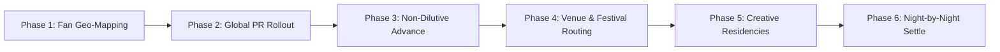

# Artist Tour Incubation & Creative Residencies: Comprehensive Guide

## 1. Introduction: From Nairobi to Worldwide
TuneMavens Tour Incubation is built on a simple premise: talent is evenly distributed across the globe, but touring infrastructure and access to advance capital are not.

Whether you are an electronic live act in Nairobi, an indie band in the Rift Valley, or a soul singer in Mombasa, TuneMavens provides the complete operational blueprint, international booking network, PR machine, and non-dilutive tour advance capital to take your live show worldwide.

---

## 2. The 6-Phase Incubation Lifecycle

### Phase 1: Audience & Fan Geo-Mapping
* Export your listener clusters from **TuneStream DSP Radar** and **Smart CRM**.
* Determine high-affinity cities where ticket pre-sales can support headline venue capacities (500 to 2,500 seats).
* Set up automated Geo-Alerts in Smart CRM to trigger SMS and WhatsApp waitlists to fans within a 50-mile radius.

### Phase 2: Strategic PR & Media Campaign
* Craft a high-impact EPK via the **EPK Builder Studio** (`/dashboard?tab=epk-builder`).
* Launch an international press blitz targeting tastemaker blogs, radio plugging (BBC 1Xtra, KEXP, NTS, Worldwide FM), and local arts weeklies 8 weeks before ticket launch.

### Phase 3: Securing Non-Dilutive Tour Financing
* Submit your tour routing and budget to the **TuneMavens Tour Vault**.
* Accredited tour venture backers fund your production advance (flights, visas, backline rental, tour bus, rehearsal spaces).
* **You retain 100% of your master and publishing rights.**

### Phase 4: Venue Routing & Booking Agency Network
* Leverage TuneMavens' relationships across North America, Europe, Africa, and Asia.
* Secure hold dates with reputable independent venue associations and marquee festival curators.

### Phase 5: Masterclasses & Studio Residencies
* Schedule daytime creative clinics, modular synthesis demos, and songwriter stem camps during tour layovers.
* Earn high-margin supplemental ticket revenue while connecting with local musicians and fans.

### Phase 6: Night-by-Night Automated Settlement
* Collect door receipts and merch sales through **TunePay Mobile POS** and integrated QR ticketing.
* Funds are split automatically according to your pre-configured smart contract rules in the **Split Cascade Ledger**, paying your crew, investor advances, and band without delays or dispute.

---

## 3. Integrated Tooling Checklist
* **EPK Builder** ([`/dashboard?tab=epk-builder`](http://localhost:3000/#/dashboard?tab=epk-builder&role=creator)): Official tour EPK with embedded live videos, technical rider, stage plot, and booking inquiries.
* **Smart CRM Studio** ([`/dashboard?tab=crm`](http://localhost:3000/#/dashboard?tab=crm&role=creator)): Geo-segmented fan broadcasts, VIP ticket presale campaigns, and SMS notifications.
* **TunePay POS Terminal** ([`/dashboard?tab=pos-terminal`](http://localhost:3000/#/dashboard?tab=pos-terminal&role=label)): On-site merch table credit card and M-Pesa payments with live inventory tracking.
* **Split Cascade Ledger** ([`/dashboard?tab=splits`](http://localhost:3000/#/dashboard?tab=splits&role=creator)): Programmatic revenue distribution between artist, band, crew, and investors.

---
*TuneMavens Artist Tour Incubation • Technical Documentation Spec §9.44*
