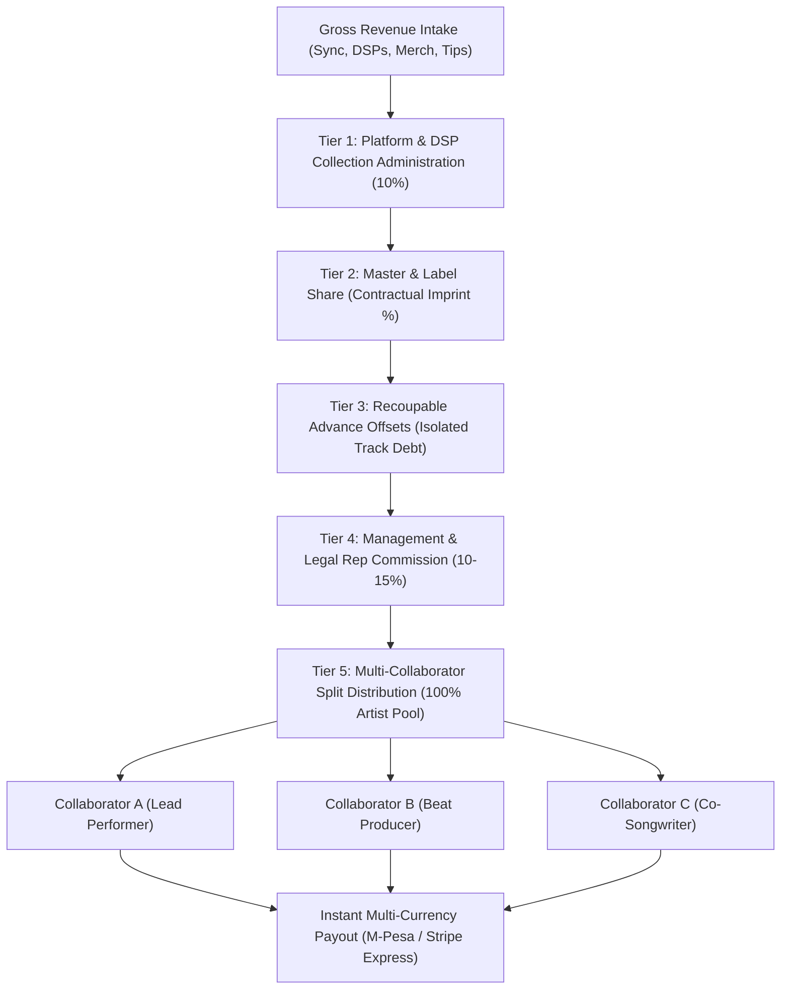

# DOCUMENTATION.md — TuneMavens Platform Reference

Canonical technical reference for the TuneMavens build. Sections §9.1–§9.7
are inherited from the shared `intermaven` platform documentation.
Sections §9.8+ are TuneMavens-specific.

Current focus: §9.8 (App Marketplace + Recommendation Agent — SHIPPED),
§9.39 (MyContracts Smart Legal Vault, Engagement Auto-Generator & E-Signature Protocol — SHIPPED),
§9.40–§9.41 (Synergy Multi-Market Localization: Simultaneous Kenya & USA Launch with Kiswahili, Gĩkũyũ & Spanish Language Engine — SHIPPED),
plus §9.9–§9.12 (Identity, Social Graph, Community, CRM — IN PLAN).

> [!NOTE]
> **Design & Localization Standards:** For the canonical reference on styling tokens, typography, buttons, header/sidebar behaviors, card layouts, scrollbars, and animations used across the TuneMavens ecosystem, see [DESIGN_STANDARDS.md](file:///c:/BOCM/Apps/tunemavens/docs/DESIGN_STANDARDS.md). For the client-side DOM localization and multi-currency engine, see [LOCALIZATION_ARCHITECTURE_GUIDE.md](file:///c:/BOCM/Apps/tunemavens/docs/LOCALIZATION_ARCHITECTURE_GUIDE.md).

---

## §9.5 — Landing Page Map & "Perfect For" Sidebar  ✅ SHIPPED (sidebar) / 🟠 P1 (role pages)

### 9.5.1 Landing page inventory

All public marketing surfaces. Every route in this table shares the
persistent **"Perfect for" sidebar** (§9.5.2) on desktop.

| Route | Purpose | Audience | Status |
|---|---|---|---|
| `/` | Root marketing (Music Operations & AI Suite) | General / Intermaven brand | ✅ Shipped |
| `/native-apps/tunemavens` | **tunestream listeners app landing — THE main consumer landing** | Consumers / fans | ✅ Shipped |
| `/native-apps/creator-companion` | tunecompanion native app | Creators (mobile promo) | ✅ Shipped |
| `/native-apps/tunepay` | tunepay native app | Merchants | ✅ Shipped |
| `/native-apps` | Gallery of all native apps | All | ✅ Shipped |
| `/tools` | AI Tools catalogue | All | ✅ Shipped |
| `/apps` | Dashboard apps catalogue | All | ✅ Shipped |
| `/pricing`, `/about`, `/help` | Supporting pages | All | ✅ Shipped |
| `/for/creator` | Role landing — Creators (Artists / Podcasters / DJs) | Creators | 🟠 Stub (Phase 2.5 = full page) |
| `/for/exec` | Role landing — Execs (Label / A&R / Industry) | Execs | 🟠 Stub |
| `/for/supervisor` | Role landing — Music Supervisors (sync) | Supervisors | 🟠 Stub |
| `/for/consumer` | Redirects to `/native-apps/tunemavens` | Consumers | 🟠 Planned redirect |
| `/for/booking-agent` | Role landing — Booking Agents | Agents | 🟠 Stub |
| `/for/manager` | Role landing — Managers | Managers | 🟠 Stub |

**Rule of thumb:** every `/for/{role}` route eventually gets a hand-crafted
marketing page in **Phase 2.5 · Identity & Roles**. Until then, the
`RoleLandingView` component in `App.jsx` renders a minimal role-tuned
hero so links from the sidebar and CRM invites don't 404.

### 9.5.2 "Perfect for" sidebar — persistent left rail

**Component:** `src/components/PerfectForSidebar.jsx`
**Rendered by:** `App.jsx` (top level, right after `<Navbar/>`; self-guards
via route allow-list)
**Route allow-list:** `/`, `/pricing`, `/about`, `/help`, `/tools`, `/apps`,
`/native-apps`, `/native-apps/*`, `/for/*`. Never renders on the dashboard,
login, or register routes.

**Layout**
- Desktop (≥961px): fixed left rail, **1/4 viewport width** (min 240px,
  max 320px), full remaining viewport height. Main content shifts right
  via `padding-left` on `.app-landing-wrapper` (uses CSS `:has()`).
- Mobile (<961px): hidden. A horizontal picker will replace it in a
  later pass (deliberately out of scope for v1).

**Header** — "PERFECT FOR" (uppercase, 11px, letter-spaced, muted grey).

**Tiles** — one per role, in this order:

| Order | Role | Route | Accent |
|---|---|---|---|
| 1 | Creators (Artists · Podcasters · DJs) | `/for/creator` | `--cyan` `#22d3ee` |
| 2 | Execs (Label · A&R · Industry) | `/for/exec` | `--purple` `#8b5cf6` |
| 3 | Music Supervisors (Sync for film & TV) | `/for/supervisor` | `--am` `#f59e0b` |
| 4 | Consumers (Everyday listeners) | `/native-apps/tunemavens` | `--gr` `#10b981` |
| 5 | Booking Agents (Book & represent live acts) | `/for/booking-agent` | `--blue` `#2563eb` |
| 6 | Managers (Day-to-day artist teams) | `/for/manager` | `#ef4444` |

**Tile spec**
- Square (`aspect-ratio: 1/1`), **3px border-radius**.
- Flat background (`#131a2e`) with subtle border. No gradients.
- Contents (vertically stacked, horizontally centred):
  1. Logo (currently a `lucide-react` icon placeholder; real logos plug
     into `PERFECT_FOR_ROLES[i].Icon` later)
  2. Label (13px, bold Outfit)
  3. Short description (10px, muted)
- Hover: background swaps to `--pf-accent` (flat, no gradient), label +
  sub swap to dark ink for contrast, subtle `translateY(-2px)` lift +
  accent shadow.
- Active (current route): same as hover but persistent — signals "you
  are here."
- Keyboard focus: 2px outlined ring in the tile's accent colour.

**Entrance animation**
- Each tile enters with `pfTileSlideIn` (620ms cubic-bezier easing):
  slides down from `translateY(-28px)`, fades in 0 → 1.
- Staggered by 80ms per tile after a 120ms opening beat — cascades
  top-to-bottom.
- Honours `prefers-reduced-motion: reduce` (falls back to static).

**Data-testids**
- `perfect-for-sidebar` — root `<aside>`
- `perfect-for-header` — the "Perfect for" `<h3>`
- `perfect-for-tile-{key}` — each tile (`creator`, `exec`, `supervisor`,
  `consumer`, `booking-agent`, `manager`)
- `role-landing-{role}` — role landing wrap
- `role-landing-not-found` — 404 fallback when the URL role is unknown

**CRM CTA default**
Any campaign in the CRM composer (§9.12) that targets a role segment
defaults its CTA URL to that segment's landing page from the table
above. Admins can override to any URL on the platform.

---

## §9.6 — User Model

`users` collection:

```
{
  _id: ObjectId,
  email: string,
  password_hash: string,
  name: string,
  brand_name: string?,

  // Multi-role support (Phase 2.5)
  roles: ('creator' | 'label' | 'dj' | 'studio' | 'supervisor'
        | 'booking_agent' | 'manager' | 'executive'
        | 'consumer' | 'admin')[],
  primary_role: string,                   // Which role's landing page they see by default
  pro_verified: bool,                     // Admin-verified pro badge (Phase 2.5)

  country: string?,                       // ISO 3166-1 alpha-2
  plan: 'free' | 'starter' | 'pro' | 'enterprise',
  credits: number,                        // Unified Network Credits
  apps: string[],                         // Activated app slugs (§9.8)
  dashboard_layout: dict?,

  // Social graph (Phase 4.5)
  bio: string?,
  avatar_url: string?,
  cover_url: string?,
  social_links: dict?,                    // { instagram, x, youtube, tiktok, spotify, ... }
  privacy_settings: dict?,                // See §9.10 Privacy Center

  created_at: datetime,
  updated_at: datetime
}
```

`apps[]` is the single source of truth for **every activation surface**:
TuneMavens dashboard panels, Intermaven Network native apps, and
Intermaven.io platform tools.

---

## §9.7 — Deal Collections

- `publishing_deals` — Publishing tier election with audit trail
  (`status: active | superseded | terminated`, `superseded_at`)
- `distribution_deals` — DSP distribution path with same audit-trail semantics
- `catalogue_acquisitions` — advance / recoupment ledger stub
- `contracts` — Contract Negotiation subsystem (locked vs negotiable clauses,
  invitees, proposals, e-signatures) — see §9.8.7

---

## §9.8 — App Marketplace + AI Recommendation Agent  ✅ SHIPPED

*(Unchanged from prior revision — see PR history.)*

### 9.8.1 App catalogue
Three groups, all persisted through `users.apps[]`:
- **TuneMavens dashboard apps** — internal panels
- **Native Apps** — marketing landing pages (`/native-apps/...`)
- **Intermaven Platform** — tools on intermaven.io (`window.open` with
  shared JWT cookie)

Slugs live in `src/lib/appCatalog.js`, `src/lib/nativeApps.js`, and
`src/lib/intermavenPlatformApps.js`. Backend allow-list mirror:
`backend/routes/users_router.py::ALLOWED_APP_SLUGS`.

**Activation Persistence Across Logins**:
Activated choices (e.g. `epk-builder`, `catalog-porting`) are tracked via `src/lib/activatedApps.js` with dual storage:
1. **Frontend Local Storage**: `tunemavens_activated_apps` and per-account keys remember choices across browser restarts, tab closures, and logouts.
2. **Backend Sync**: Synchronized with `users.apps[]` via `POST /api/users/me/apps` and `PUT /api/users/me/apps`.
3. **Sidebar Continuity**: Activated apps always appear in the sidebar under their respective categories on every login until explicitly deactivated by the user via the App Marketplace. Explicit deactivations are saved to `tunemavens_deactivated_apps` and `DELETE /api/users/me/apps/{slug}`.

### 9.8.2 Onboarding questionnaire
`onboarding_responses` — keyed by `user_id`, upserted. Multi-select
`primary_goal` and `revenue_focus` arrays; every question has an
`{key}_other` free-text sibling for the LLM to interpret.

### 9.8.3 Activity signals
`activity_events` — append-only. `kind ∈ { tab_visit, deal_created,
app_activated, app_deactivated, stripe_progress }`. Aggregated by
`_activity_summary(user_id)`.

### 9.8.4 Recommendation Agent
Two-layer synthesis: **LLM primary** (Claude Sonnet 4.6, 15s cap, strict
JSON) with **rules fallback** (deterministic scorer). Always returns
picks. Output: `[{ slug, rationale, priority, source: 'llm' | 'rules' }]`.

### 9.8.5 UX surfaces
- **OnboardingStripe** — top-of-dashboard checklist
- **App Marketplace › Your Path tab** (default) — Recommended for you hero
- **Marketplace tabs**: TuneMavens Apps / Native Apps / Intermaven Platform

### 9.8.6 API surface
```
GET    /api/users/me/apps                      → string[]
POST   /api/users/me/apps                      → string[]    body: { slug }
DELETE /api/users/me/apps/{slug}               → string[]
GET    /api/users/me/onboarding                → OnboardingResponse | null
POST   /api/users/me/onboarding                → OnboardingResponse
POST   /api/users/me/activity                  → { ok: true }
GET    /api/users/me/recommendations?limit=N   → Recommendation[]
```

### 9.8.7 Contract Negotiation subsystem
Industry-standard clause templates for `publishing`, `distribution`,
`catalogue_acquisition`. Locked (non-negotiable) vs negotiable clauses.
Invite counterparties by email + shareable link (WhatsApp / SMS / email).
Propose edits, accept/reject, e-sign. Implemented in
`backend/services/contract_templates.py` and `backend/routes/contracts.py`.

---

## §9.9 — Identity & Roles  🟠 P1 (Phase 2.5)

TuneMavens is a multi-role community, so every user carries a
`roles: string[]` array — a supervisor who also DJs picks both.

### 9.9.1 Role catalogue
```
creator | label | dj | studio | supervisor
| booking_agent | manager | executive | consumer | admin
```

### 9.9.2 Role-specific landing pages
Each role has a public marketing landing page at `/for/{role}` with
role-tuned hero copy, testimonials, and CTAs. CRM invites default their
CTA to the recipient's `primary_role` landing page.

### 9.9.3 Pro-verified badge
Admin-only field (`users.pro_verified`). Shown as a badge on public
profiles. Signals authority but never gates access — every profile is
equally visible unless the owner has enabled industry-only mode in the
Privacy Center (discouraged; §9.10).

### 9.9.4 API surface
```
GET    /api/users/me/roles                     → string[]
PATCH  /api/users/me/roles                     → string[]    body: { roles: string[], primary_role: string }
POST   /api/admin/users/{id}/pro-verify        → { pro_verified: true }
GET    /api/for/{role}                         → LandingPageMeta   (role landing metadata)
```

---

## §9.10 — Social Graph  🟠 P1 (Phase 4.5)

### 9.10.1 Data model
```
follows: { follower_id, followee_id, kind: 'follow' | 'subscribe', created_at }
likes:   { user_id, target_kind: 'post' | 'profile' | 'song', target_id, created_at }

// Fanout stream (append-only, TTL-indexed for the home feed)
activity_events (extended from §9.8.3):
  kind ∈ { tab_visit, deal_created, app_activated, app_deactivated,
           stripe_progress,
           // New in Phase 4.5:
           listen, download, tip, follow, like, subscribe,
           contract_signed, wall_of_fame_featured }
  visibility: 'public' | 'connections' | 'private'   // Derived from Privacy Center
```

### 9.10.2 Privacy Center
Per-signal toggles stored on the user record:
```
users.privacy_settings = {
  listens:      'public' | 'connections' | 'private',
  downloads:    'public' | 'connections' | 'private',
  tips:         'public' | 'connections' | 'private',
  deals:        'public' | 'connections' | 'private',
  follows:      'public' | 'connections' | 'private',
  second_degree_visible: bool,   // Whether OTHERS can see YOU through their friends
  industry_only_profile: bool    // Discouraged toggle — profile visible to pro_verified only
}
```
Defaults: all `public`, `second_degree_visible: true`, `industry_only_profile: false`.

### 9.10.3 2nd-degree discovery
`GET /api/graph/second-degree?target_kind=deal_maker` returns users you
are 2 hops from, filtered by role and by mutual friend. Powers the
"Deal-makers your friends know" panel.

### 9.10.4 Home feed
`GET /api/feed?cursor=...` returns a merged, chronological stream of:
- Direct follows' activity (listens, downloads, tips, deals — filtered by their privacy)
- Subscribed pages' new posts
- Wall of Fame highlights
- Suggested connections (2nd-degree)

### 9.10.5 API surface
```
POST   /api/users/{id}/follow                  → { following: true }
DELETE /api/users/{id}/follow                  → { following: false }
POST   /api/users/{id}/subscribe               → { subscribed: true }
POST   /api/likes                              → { liked: true }        body: { target_kind, target_id }
GET    /api/users/me/privacy-settings          → PrivacySettings
PATCH  /api/users/me/privacy-settings          → PrivacySettings
GET    /api/feed                               → FeedItem[]
GET    /api/graph/second-degree                → User[]                 query: ?role=&limit=
```

---

## §9.11 — Community & Wall of Fame  🟠 P1 (Phase 5.5)

### 9.11.1 Data model
```
featured_profiles: {
  _id,
  subject_name: string,               // "Rick Rubin"
  subject_email: string?,             // Where the invite goes
  youtube_channel_handle: string,     // "@rickrubin" or channel_id
  youtube_video_id: string?,          // Auto-populated by refresh job
  youtube_thumbnail_url: string?,     // Ditto
  bio: string,
  social_links: dict,
  claimed_user_id: ObjectId?,         // Set when subject accepts and creates an account
  state: 'pending' | 'invited' | 'claimed' | 'declined' | 'expired',
  invited_at: datetime?,
  claimed_at: datetime?,
  visible: bool,                      // Derived: true only if state == 'claimed'
  created_by_admin_id: ObjectId,
  created_at: datetime,
  updated_at: datetime
}
```

### 9.11.2 YouTube integration
**Provider:** YouTube Data API v3
**Auth:** Google Cloud API key (server-side; free tier 10,000 units/day)
**Cost per feature:** ~101 units per `search.list` (100 for search + 1
for videos.list). Well under quota for the Wall of Fame use case.

**Fetch flow (server-side job):**
1. `search.list?channelId={id}&order=viewCount&maxResults=1` → top video
2. `videos.list?id={video_id}&part=snippet,statistics` → title, thumbnail,
   view count
3. Cache result on `featured_profiles`. Refresh nightly.

### 9.11.3 Invite claim flow
1. Admin creates a `featured_profiles` entry (state: `pending`)
2. Admin clicks "Send invite" → CRM (§9.12) delivers via preferred channel
3. Invite CTA lands on `/wall-of-fame/claim/{token}`
4. Subject completes interests modal (Phase 3 onboarding wizard, prefilled)
5. Free account created → `featured_profiles.state = claimed`,
   `featured_profiles.visible = true`
6. Tile now renders publicly at `/community/wall-of-fame`

### 9.11.4 UX surfaces
- **`/community/wall-of-fame`** — public grid, only `visible == true` tiles
- **Admin `/admin/community`** — full CRUD of `featured_profiles`,
  including preview of unclaimed tiles

### 9.11.5 API surface
```
GET    /api/community/wall-of-fame                     → FeaturedProfile[]  (visible only)
GET    /api/admin/wall-of-fame                         → FeaturedProfile[]  (all states)
POST   /api/admin/wall-of-fame                         → FeaturedProfile    body: { subject_name, channel_handle, ... }
POST   /api/admin/wall-of-fame/{id}/invite             → { invited: true }
POST   /api/admin/wall-of-fame/{id}/refresh-youtube    → FeaturedProfile
POST   /api/community/wall-of-fame/claim/{token}       → { user_id, redirect: '/dashboard' }
```

---

## §9.12 — CRM & Growth Engine  🟠 P1 (Phase 6.5)

### 9.12.1 Data model
```
campaigns: {
  _id,
  name: string,
  segment: {
    roles: string[]?,               // Filter by role
    country: string?,
    plan: string?,
    pro_verified: bool?,
    custom_query: dict?             // Mongo query for advanced segmentation
  },
  channels: ('email' | 'in_app' | 'social_dm')[],
  template: {
    subject: string,                // For email + in_app
    body_markdown: string,          // Rich text with {{name}} {{role}} tokens
    cta_label: string,
    cta_url: string                 // Defaults to /for/{primary_role}
  },
  stats: { sent, delivered, opened, clicked, replied, failed },
  created_by_admin_id, created_at, updated_at,
  scheduled_at: datetime?,
  status: 'draft' | 'scheduled' | 'sending' | 'sent' | 'paused'
}

campaign_sends: {
  campaign_id,
  user_id: ObjectId?,               // null for external prospects
  external_email: string?,          // For invites to non-users (Wall of Fame subjects)
  channel: 'email' | 'in_app' | 'social_dm',
  state: 'queued' | 'sent' | 'delivered' | 'opened' | 'clicked' | 'replied' | 'failed' | 'marked_sent',
  attempts: int,
  sent_at, delivered_at, opened_at, clicked_at
}

messages (in-app inbox):
{
  _id,
  thread_id,                        // Groups a conversation
  from_user_id,                     // null == system/admin campaign
  to_user_id,
  campaign_id?,
  subject, body_markdown, cta_label?, cta_url?,
  read_at: datetime?,
  created_at
}
```

### 9.12.2 Channel adapters
| Channel | Adapter | Third party |
|---|---|---|
| `email` | Resend (`resend-python`) | ✅ Resend (required) |
| `in_app` | `messages` collection + WebSocket/polling | — |
| `social_dm` | Renders template → clipboard button + "Mark as sent" | — (admin posts manually) |
| `sms` | *(interface reserved, not implemented)* | Deferred |

Adapter interface (Python):
```python
class ChannelAdapter(Protocol):
    def send(self, send: CampaignSend, template: Template) -> SendResult: ...
```

### 9.12.3 Composer UI (admin)
1. **Segment** — role multi-select, country, plan filters (live count).
2. **Channels** — check email, in_app, social_dm.
3. **Template** — rich-text editor with token autocomplete (`{{name}}`,
   `{{role}}`, `{{cta_url}}`).
4. **CTA URL picker** — dropdown of all platform routes; defaults to the
   segment's role landing page (`/for/{primary_role}`).
5. **Preview** — rendered per channel with sample recipient.
6. **Schedule/send** — immediate or scheduled.

### 9.12.4 In-app inbox
User-facing `/inbox` route. Shows all `messages` where the user is
`to_user_id`. Supports:
- Read/unread state
- Reply to system messages (creates a thread)
- Filter by campaign
- CTA button rendered inline

### 9.12.5 API surface
```
# Admin composer
GET    /api/admin/campaigns                    → Campaign[]
POST   /api/admin/campaigns                    → Campaign
PATCH  /api/admin/campaigns/{id}               → Campaign
POST   /api/admin/campaigns/{id}/preview       → { html, text, in_app_preview, social_dm_preview }
POST   /api/admin/campaigns/{id}/send          → { queued: number }
GET    /api/admin/campaigns/{id}/sends         → CampaignSend[]
POST   /api/admin/campaigns/{id}/sends/{sid}/mark-sent  → { marked_sent: true }  # For social_dm

# User inbox
GET    /api/users/me/inbox                     → Message[]      query: ?unread=true&thread_id=
POST   /api/users/me/inbox/{id}/read           → { read: true }
POST   /api/users/me/inbox/{id}/reply          → Message        body: { body_markdown }

# Public webhook (Resend delivery events)
POST   /api/webhooks/resend                    → { ok: true }   # Updates CampaignSend state
```

### 9.12.6 Environment variables
```
RESEND_API_KEY=...
RESEND_FROM_EMAIL="TuneMavens <hello@tunemavens.com>"
RESEND_WEBHOOK_SECRET=...
YOUTUBE_API_KEY=...
```

---

## Third-party integrations summary

| Service | Section | Env vars | Free tier |
|---|---|---|---|
| Claude Sonnet 4.6 (Emergent) | §9.8.4 | `EMERGENT_LLM_KEY` | Prepaid budget |
| YouTube Data API v3 | §9.11.2 | `YOUTUBE_API_KEY` | 10,000 units/day |
| Resend | §9.12.2 | `RESEND_API_KEY`, `RESEND_FROM_EMAIL`, `RESEND_WEBHOOK_SECRET` | 3,000 emails/mo |

**Explicitly NOT integrated:**
- SMS providers (Twilio, etc.) — deferred; interface reserved
- Instagram/X APIs — never; social DM is admin copy-to-clipboard by design

---

## §9.13 — Platform UI & Layout Rules

### 9.13.1 App Cards Horizontal Centering Rule
To maintain visual consistency and clean design alignment across all marketing, native, and platform app surfaces:
- **Horizontal Centering:** All content within any app cards (such as `.app-card`, `.native-app-card`, and custom app showcase cards) must be centered horizontally within its box.
- **Card Flex Styling:** Cards should use flex layouts with `flex-direction: column`, `align-items: center`, and `text-align: center`.
- **Inner elements:** Header groupings, target badges, icons/logos, paragraphs, bullet lists (`.native-app-features`), and CTA action store buttons must center align within the card boundaries.
- **Exceptions:** General dashboard admin panel cards that display complex layout tables or form forms may align left where readability demands it, but native marketing cards must adhere strictly to centering.

### 9.13.2 Unified Backend Admin Layout Rules
To ensure all platform sub-applications appear as a unified product ecosystem:
- **Structure Alignment:** The admin layouts for all utilities (TuneStream, SyncMavens) must mirror the main portal dashboard’s collapsible sidebar (`dashboard-sidebar`), topbar (`dashboard-topbar`), scrollable container (`dashboard-main-scroll`), and footer copyright strip (`dashboard-copyright-strip`).
- **Branding Accents:** Sidebar headers must display the respective sub-utility logo relative to the active target domain (TuneStream logo, SyncMavens logo, etc.).
- **Nav Collapsibility:** Sidebars must support collapsible state toggles that transition smoothly between standard (260px) and collapsed (80px) widths, modifying padding and text visibility accordingly.
- **Sandbox Role Switches:** Sidebars or topbars must provide visible sandboxed role/view switcher controls (e.g. switching between Creator and Listener views in TuneStream) to simplify testing.

---

## §9.14 — Codebase Structure & Directory Layout  ✅ SHIPPED (Landing/Auth/Consumer) / 🟠 P1 (Dashboard)

To ensure high modularity and avoid side-effects from monolithic files, the codebase is structured as a component-and-view hierarchy:

```
src/
├── components/
│   ├── common/
│   │   ├── PageHeader.jsx          # Shared title and background headers
│   │   ├── Navbar.jsx              # Unified navigation header
│   │   ├── Footer.jsx              # Global footer menus with region context
│   │   └── FaqItem.jsx             # Self-contained accordion element
│   └── demos/
│       ├── SyncBriefDemo.jsx       # Interactive AI brief mockup generator
│       ├── MasteringDemo.jsx       # Studio quality preview mastering testbed
│       ├── SplitCalculatorDemo.jsx # Mockup splits generator
│       ├── SyncBriefCarousel.jsx   # Horizontal sync showcase
│       ├── SplitCascadeCarousel.jsx# Payout stages slideshow
│       ├── UserPersonaCarousel.jsx # Target industry segment showcase
│       ├── ComingSoonApp.jsx       # Generic dashboard app placeholder
│       ├── SplitCascadeLedgerApp.jsx# Standalone ledger app mockup
│       └── MpesaPosTerminal.jsx    # Standalone terminal pos flow mockup
├── views/
│   ├── landing/
│   │   ├── HomeView.jsx            # Platform home / general landing page
│   │   ├── ToolsView.jsx           # AI Tools catalog landing page
│   │   ├── AppsView.jsx            # Standalone apps list page
│   │   ├── NativeAppsView.jsx      # Standalone native apps catalog page
│   │   ├── NativeAppLandingView.jsx# Rich Capacitor app landing pages
│   │   ├── PerfectForPageView.jsx  # Landing directories of industry roles
│   │   ├── RoleLandingView.jsx     # Minimal target hero route stubs
│   │   ├── PricingView.jsx         # Pay-as-you-go packages pricing table
│   │   ├── AboutView.jsx           # About page with contact submission
│   │   ├── HelpView.jsx            # Help center FAQ and support tickets
│   │   └── TuneStreamViews.jsx     # Consumer app marketing pages
│   ├── auth/
│   │   ├── LoginView.jsx           # Secure SSO + sandbox login form
│   │   └── RegisterView.jsx        # Step-by-step onboarding signup wizard
│   ├── consumer/
│   │   ├── StreamView.jsx          # Lossless consumer player dashboard
│   │   └── TuneStreamViews.jsx     # TuneStream specific info pages
│   └── dashboard/                  # [Planned] Dashboard core & utility panels
│       ├── DashboardView.jsx       # Primary Dashboard layout
│       └── panels/                 # Dashboard feature utility modules
```

### 9.14.1 Root App Routing
The main `src/App.jsx` handles core app state (Unified Auth context & regional context), global CSS initialization, and the client-side router configurations. The modular views are dynamically imported at the top of the file, keeping the central file lightweight, readable, and highly maintainable.

---

## §9.15 — Multi-Domain Architecture & Deployment Plan

### 9.15.1 Architectural Recommendation: Monorepo with Multi-Build Targets
Rather than splitting the TuneMavens ecosystem into entirely separate repositories (which introduces code duplication, auth sync overhead, and database mapping complexity), we recommend utilizing a **Monorepo structure with separate application build targets**.

This layout allows:
- **Shared Authentication & Session State:** Single shared FastAPI backend session, user collections, and common domain cookies (`COOKIE_DOMAIN=.tunemavens.com`).
- **Shared Components & Libraries:** All UI elements (design tokens, layout grids, components) reside in a single repository and can be imported across utilities.
- **Independent Servability:** Each domain serves its own isolated frontend code bundles.

#### Directory Layout
```
tunemavens/
├── apps/
│   ├── portal/           # Main portal & dashboards (tunemavens.com)
│   │   ├── index.html
│   │   └── src/
│   ├── tunestream/       # TuneStream Consumer App (tunestream.co / tunestream.tunemavens.com)
│   │   ├── index.html
│   │   └── src/
│   └── syncmavens/       # SyncMavens Utility (syncmavens.com)
│       ├── index.html
│       └── src/
├── packages/
│   ├── shared-ui/        # Shared components, hooks, design system, styling
│   └── shared-auth/      # Shared authentication state and helpers
├── backend/              # Unified FastAPI backend
└── deploy/               # Multi-domain VPS deployment configs
```

---

### 9.15.2 DNS Mapping & User-Specific Routing Strategy

To ensure that each platform, page, action, and Call-to-Action (CTA) is specific to the authenticated user's role and portal context, we employ a multi-domain routing layout:
1. **Primary Hub Domains**: Major standalone properties use dedicated domains.
2. **Subdomain-based Routing**: Specialized role portals default to subdomains under the main `tunemavens.com` namespace.

| Domain | DNS Target | Maps to | Role/Ecosystem Context |
|---|---|---|---|
| `tunemavens.com` | `A` record pointing to VPS IP | Main Portal & Dashboard | Core Hub, Creators & General Users |
| `www.tunemavens.com` | `CNAME` pointing to `tunemavens.com` | Main Portal & Dashboard | Core Hub, Creators & General Users |
| `tunestream.co` | `A` record pointing to VPS IP | TuneStream Utility | Audio Stream Listeners & Fans |
| `www.tunestream.co` | `CNAME` pointing to `tunestream.co` | TuneStream Utility | Audio Stream Listeners & Fans |
| `tunestream.tunemavens.com` | `CNAME` pointing to `tunestream.co` | TuneStream Utility | Fan Redirect/Alias |
| `syncmavens.com` | `A` record pointing to VPS IP | SyncMavens Utility | Sync Licensing & Music Supervisors |
| `www.syncmavens.com` | `CNAME` pointing to `syncmavens.com` | SyncMavens Utility | Sync Licensing & Music Supervisors |
| `djs.tunemavens.com` | `CNAME` pointing to `tunemavens.com` | DJ Pool Portal | DJs |
| `corporate.tunemavens.com` | `CNAME` pointing to `tunemavens.com` | Corporate Portal | Business & Organization accounts |
| `media.tunemavens.com` | `CNAME` pointing to `tunemavens.com` | Media House Portal | Media House routing |

Each interface dynamically parses the incoming request domain or host header (`Request.headers.get('host')` in FastAPI and `window.location.hostname` in React) to:
- Render role-specific navigation menus and action steps.
- Set platform-specific styling (branding colors and logos).
- Scope payment packages, credits, and CTA behaviors to that specific user context.

---

### 9.15.3 Hostinger VPS Nginx Configuration
On the Hostinger VPS, Nginx is updated to support independent server blocks pointing to the respective build directory targets.

```nginx
# 1. Main Portal (tunemavens.com)
server {
  listen 80;
  server_name tunemavens.com www.tunemavens.com;

  root /opt/tunemavens/dist/portal;
  index index.html;

  location /api/ {
    proxy_pass http://127.0.0.1:8001;
    proxy_set_header Host \$host;
    proxy_set_header X-Real-IP \$remote_addr;
  }

  location / {
    try_files \$uri \$uri/ /index.html;
  }
}

# 2. TuneStream (tunestream.co & tunestream.tunemavens.com)
server {
  listen 80;
  server_name tunestream.co www.tunestream.co tunestream.tunemavens.com;

  root /opt/tunemavens/dist/tunestream;
  index index.html;

  location /api/ {
    proxy_pass http://127.0.0.1:8001;
    proxy_set_header Host \$host;
    proxy_set_header X-Real-IP \$remote_addr;
  }

  location / {
    try_files \$uri \$uri/ /index.html;
  }
}

# 3. SyncMavens (syncmavens.com)
server {
  listen 80;
  server_name syncmavens.com www.syncmavens.com;

  root /opt/tunemavens/dist/syncmavens;
  index index.html;

  location /api/ {
    proxy_pass http://127.0.0.1:8001;
    proxy_set_header Host \$host;
    proxy_set_header X-Real-IP \$remote_addr;
  }

  location / {
    try_files \$uri \$uri/ /index.html;
  }
}
```

---

### 9.15.4 Deployment & CI/CD Pipeline (GitHub Actions)
Upon every push to `main`, the deployment workflow builds each app target independently and uploads them to the corresponding directories:

1. **Build Step:**
   ```bash
   npm run build --workspace=portal --dest=dist/portal
   npm run build --workspace=tunestream --dest=dist/tunestream
   npm run build --workspace=syncmavens --dest=dist/syncmavens
   ```
2. **Deploy Step:**
   The `deploy.sh` script copies the respective `dist/` sub-directories to the VPS root:
   - `/opt/tunemavens/dist/portal`
   - `/opt/tunemavens/dist/tunestream`
   - `/opt/tunemavens/dist/syncmavens`

---

## §9.16 — SyncMavens Ditto-inspired Platform & Backend Support

### 9.16.1 Ditto Music Marketing & Compensation Model
- **Public Landing Page:** Located at the root of the `syncmavens.com` domain. It mimics Ditto Music’s "Get Signed" layout with high-impact pitching marketing, client list logos (Netflix, HBO, EA Sports), custom FAQs, and step-by-step sync signing walkthroughs.
- **Easy Accessibility:** A barrier-free, open-access portal for independent creators to upload catalog stems directly to supervisor search indexes.
- **Compensation & Waterfall Model:** Rather than traditional upfront catalog buyouts, SyncMavens works on a placement-led 90/10 split waterfall. Creators receive 90% of sync licensing fees, while SyncMavens retains a 10% administration/facilitation fee.
- **No Catalog Advances:** **We do not offer catalog sign advances at this stage**, ensuring creators maintain 100% ownership control of their catalog publishing rights and mechanical copyrights.
- **CTA Ingress:** Directs creators via a prominent "Access Sync Dashboard" button into the unified Sync Admin Dashboard.

### 9.16.2 Interactive Landing Page Utilities
- **AI Sync Match Simulator:** Form-based utility allowing creators to simulate track metadata match calculations against live briefs. Employs transition loadings ("Transcoding stems...", "Iterating budgets...") and outputs a detailed match score (%), compatible project, fee payout, and pitch claim actions.
- **Splits Cascade Calculator:** Visual waterfall diagram that displays dynamic Writer/Producer payouts relative to a chosen sync buyout fee, reflecting the flat 10% SyncMavens administration fee and $0 catalog advance payouts.

### 9.16.3 Backend Collection Support
- **`briefs` Collection:** Stores incoming film, TV, and video game licensing sync briefs. Schema mirrors standard contract briefs: project name, client, budget, duration format, deadline, required genre style, and description details.
- **`pitches` Collection:** Tracks pitched catalog tracks submitted by creators to active briefs.
- **`catalogs` Collection:** Index of masters and metadata ingested for sync matching, linked with split cascade agreements.

---

## §9.17 — Track D: Social AI Studio Recommendations & Mother-EPK Integration

### 9.17.1 Social AI Studio Path Asset Recommendations
- **Path-Based Suggestions:** The Social AI Studio recommends specific creative assets (such as aspect ratios, file types, and style guidelines) matching the campaign's recommended marketing channel path. For example, if the marketing path recommends **Facebook** and **Instagram**, the Studio automatically suggests creating Square (1:1) and Vertical Short (9:16) assets.
- **Intermaven Integration:** The Social AI Studio is linked to the Intermaven Social AI scheduling and dispatch app, which automates social posting, queue management, and goal metrics tracking.

### 9.17.2 Intermaven EPK Builder Integration
- **Platform Parity:** The EPK Builder in TuneMavens is identical to the one on the Intermaven platform. Intermaven serves as the parent ("mother") platform, ensuring that all templates, metadata fields, and media asset associations are synchronized.
- **Activation Lifecycle:** Creators can activate or deactivate the EPK Builder app dynamically from the **App Marketplace** in the admin panel.

---

## §9.18 — Standalone Creator Web Worlds (EPK) & Multi-Domain Ingress Engine

### 9.18.1 Multi-Domain Subdomain & Custom Ingress
Creators have the flexibility to publish and host their Standalone Creator Web World across multiple high-traffic ecosystem domains:
- **Tri-Domain Availability:** The wizard allows simultaneous deployment to:
  - `{subdomain}.tunemavens.com` (Main Creator Hub)
  - `{subdomain}.tunestream.co` (Consumer Streaming Portal)
  - `{subdomain}.syncmavens.com` (Music Supervisor Sync Licensing Hub)
- **Custom Domains:** Supports mapping a fully custom domain (e.g. `artistname.com`) directly to the creator's EPK container.

### 9.18.2 Site Name, Tagline & Dynamic SEO Indexing
- **First Step Inputs:** The EPK Wizard captures `siteName` and `tagline` during initial onboarding.
- **SEO Title Protocol:** Dynamically sets browser `<title>` and OpenGraph tags to `{siteName} | {tagline}`.
- **Header Display Rules:** If a custom logo image is uploaded, the site name text is hidden to prevent redundancy; if no logo exists, the styled artist/site name appears. Extraneous raw URLs below logos are omitted for clean branding.

### 9.18.3 Multi-Slide Hero Carousel & Contextual AI Generation
- **Hero Carousel:** Supports up to 6 high-definition hero slides with custom or AI-generated artwork.
- **3-Line Music Business Hierarchy:**
  1. `heroTitle1`: Creator / Artist Name.
  2. `heroTitle2`: Dynamic Tagline / Campaign Headline.
  3. `heroTitle3`: Standardized Music Business Context (e.g. *100% Pre-Cleared One-Stop Sync Licensing & Master Stems • TuneStream Lossless*).
- **Context-Aware AI Generation:** AI prompts are tuned to music business roles (Sync Composer, Touring Artist, Indie Label), generating tailored imagery and titles with full upload replacement capabilities.
- **Hero Animation Modes:**
  - `anim-synergy`: Multi-phase dynamic stagger matching modern landing animations.
  - `anim-fade-seq`: Elegant sequential fade-in / fade-out transition between titles and background imagery.

### 9.18.4 Social Account Validation & Sync Check
- **Supported Networks:** Instagram, YouTube, Spotify, SoundCloud, TikTok, Twitter/X, and Apple Music.
- **Sync Engine:** Validates usernames and URLs via regular expression checks, displaying live sync status indicators and link health checks.

### 9.18.5 Intermaven Smart CRM Lead Routing
- **Contact & Booking Forms:** Submissions from the EPK's Booking and Contact modules directly submit to the Intermaven Smart CRM backend (`POST /api/crm/leads`).
- **Lead Segmentation:** Automatically populates lead type (`booking_inquiry`, `sync_request`, `fan_vault`), capturing contact details, event dates, budgets, and messages for direct follow-up in the admin CRM panel.

---

## §9.19 — Mother-CMS Backend EPK Architecture & Live Studio Subsystem

### 9.19.1 Centralized Backend CMS Endpoints (`backend/routes/cms_router.py`)
All Creator Web World CMS operations reside in the FastAPI backend:
- `GET /api/cms/epk/{subdomain}`: Fetches active Mother-CMS layout (`layout_id: epk_{subdomain}`) and version.
- `POST /api/cms/epk/{subdomain}`: Publishes full EPK layout, increments version, and writes immutable snapshots to `db.cms_layout_history`.
- `PATCH /api/cms/epk/{subdomain}/sections/{section_id}`: Performs granular section updates (Bio, Hero, Catalog, Shows, Media, Store).
- `POST /api/cms/epk/bio/generate`: Generates rich HTML narrative content focused on master rights, 24-bit stems, and sonic identity.
- `GET /api/cms/epk/{subdomain}/history`: Returns the version snapshot audit trail.
- `POST /api/cms/epk/{subdomain}/rollback/{version}`: Restores any historical snapshot with 1-click execution.

### 9.19.2 Floating Live Mother-CMS Studio (`LiveEpkCmsStudio.jsx`)
- Provides an overlay drawer for creators to modify any section in real time.
- Integrated rich text canvas, color pickers, animation toggles, and live rollback selector without disrupting the public view.

---

## §9.20 — Layout & 1280px Container Standards

### 9.20.1 Global Container Standard (`index.css`)
- `.container` is strictly defined as:
  ```css
  .container {
    max-width: 1280px;
    width: 100%;
    margin: 0 auto;
    padding: 0 24px;
    box-sizing: border-box;
  }
  ```
- Constrains all content below the hero section across the entire TuneMavens portal, including `PerfectForSidebar` and all interior pages (`Tools`, `Apps`, `Pricing`, `About`, `Help`, `Publishing`, `Distribution`, `Tours`, `Sync`, `Native Apps`).

### 9.20.2 Landing Content Split Grid (`App.css`)
- `.landing-content-split` enforces `max-width: 1280px; width: 100%; margin: 48px auto 0; padding: 0 24px; box-sizing: border-box;`, ensuring that flagship cards, persona carousels, frustration cards, and CTA banners never stretch past 1280px on ultra-wide screens.

### 9.20.3 Hero Controls & Footer Grid Alignment
- Hero side navigation arrows (`.sui-arrows`) and bottom indicators (`.sui-bottom`) are bound to `max-width: min(1280px, 100% - 48px)`.
- Navbar (`.nav-inner-container`) and Footer (`.footer-inner-container`) are locked to `max-width: 1280px; margin: 0 auto; box-sizing: border-box;`.
- Creator EPK footer and bottom branding bar are bound to `maxWidth: maxContentWidth` (1280px in wide layout), maintaining strict grid harmony across all marketing and creator surfaces.

---

## §9.21 — Comprehensive Creator Web World, Mother-CMS Studio & Setup Wizard Modals

### 9.21.1 Dedicated Full Event Showcase & Ticketing Protocol
- **Route / State:** `activeTab === 'event-detail'` in `CreatorEpkView.jsx`.
- **Hero & Venue Architecture:** Displays high-resolution tour flyers, venue name, city, performance date, doors open, and age restrictions (All Ages, 18+, 21+).
- **Multi-Tier Ticketing:** General Admission, VIP Balcony (includes laminate), and VIP Meet & Greet (soundcheck + photo + exclusive merchandise).
- **Multi-Rail Checkout:**
  - Full Credit/Debit Card fields: Cardholder Name, 16-digit Card Number, Expiration Date (`MM/YY`), CVC/CVV, Postal / ZIP Code, and Country selection.
  - Direct TM Credit instant debit.
  - Instant M-Pesa STK Push / PesaPal mobile rails.
- **QR Digital Ticket Pass:** Checkout generates a digital boarding pass with unique QR code, pass ID (`TM-TKT-...`), and wallet integration.

### 9.21.2 Dedicated Full Album Page & TuneStream 30s Free Preview Protocol
- **Route / State:** `activeTab === 'album-detail'`.
- **Liner Notes & Sonic Credentials:** Showcases 280x280 vinyl cover art, master metadata, 24-Bit / 96kHz FLAC badge, studio synthesizer specifications (Moog One, Prophet-6, Eurorack Modular), Executive Producers, and Publisher (e.g. *Intermaven Songs / ASCAP*).
- **TuneStream Audio Player Integration:** Dedicated player positioned directly beneath primary action buttons. Plays the first 30 seconds for free with countdown timer; continuing playback consumes 1 TM Credit matching the canonical TuneStream streaming protocol.

### 9.21.3 Commercial Access Tiering & Practitioner Role Verification
- **Buy Full Album ($9.99 / 50 Credits):** Available to all fans and VIP vault members.
- **Buy Stems:** Restricted to industry practitioners (producers, DJs, labels, music supervisors) via a 1-click Practitioner Role Verification modal.

### 9.21.4 Universal In-Context Quick Top-Up System
- Triggered whenever an action requires credits or via the "+ Top-Up Credits" button on the balance section.
- **Quick Packs:** 50 Credits ($9.99), 150 Credits ($24.99), 350 Credits ($49.99).
- **Custom Amount Slot:** Strictly enforces minimum $5.00 USD (USA / Global) and minimum KES 200 (Kenya / East Africa).
- Multi-rail payment via Card and instant M-Pesa STK push.

### 9.21.5 Mother-CMS Setup Wizard Modals
All four primary configuration workflows launch in dedicated, responsive **Modal Dialogs** with background blur (`backdropFilter: 'blur(10px)'`):
1. **Discography Release Setup Wizard** (`discographyWizardOpen`):
   - Step 1: Release Details & Musical Metadata (Title, Single/EP/Album/Stems, Year, Genre, BPM, Key).
   - Step 2: Master Audio (WAV/FLAC) & Multitrack Stems (ZIP) URLs, ISRC Code, Duration.
   - Step 3: High-Res Cover Artwork + 1-Click AI Cover Generator with custom prompts.
   - Step 4: Songwriters, Producers, Publisher & PRO, Credits & USD Pricing, Practitioner-Only Stems toggle.
   - Step 5: Review & Ingest into Discography.
2. **Store & Merch Setup Wizard** (`storeWizardOpen`):
   - Step 1: Product Basics & Category (Vinyl, Apparel, Stems, Digital, VIP Bundles).
   - Step 2: Multi-Image Carousel (Primary angle + multi-angle carousel shots).
   - Step 3: Product Description, Materials & Delivery Specs.
   - Step 4: Pricing in USD & Credits, Inventory Stock Level.
3. **Press & EPK Setup Wizard** (`pressWizardOpen`):
   - Step 1: EPK Headline Hook & Pitch Angle.
   - Step 2: Lead Editorial Quotes & Publication Outlets.
   - Step 3: Front-of-House Console & Technical Rider Summary.
   - Step 4: High-Res Assets & Direct PDF Press Kit Export.
4. **Tours & Live Shows Setup Wizard** (`showsWizardOpen`):
   - Step 1: Venue Name, City, Country, Capacity.
   - Step 2: Performance Date, Doors Open, Age Restrictions.
   - Step 3: Multi-Tier Tickets (GA, VIP Balcony, VIP Meet & Greet, On-sale status).
   - Step 4: Tour Flyer Artwork URL, Event Description & Special Guest Lineup.

### 9.21.6 Discography Ingestion Hub (`activeTab === 'music'`)
- Renamed from "Singles & Stems" to **"Discography"** (`RiDiscFill`) in CMS Studio.
- **Singles & Master Tracks:** High-resolution cover artwork, title, release, ISRC code, stems credits, direct audio masters, and 1-click AI Cover Generator with custom prompts.
- **Studio Albums & Master Collections:** Tracklists, album artwork, release dates, comprehensive liner notes, and dual USD/credits pricing.
- **Bulk Catalog CSV Ingestion:** Purpose-built for labels and publishers to paste hundreds of tracks (`Title, Year, Type, ISRC, Streams, Duration, Credits`) with instant 1-click batch ingestion into MongoDB.

---

## §9.22 — Native Intermaven Smart CRM Studio & Fan Vault Engine

### 9.22.1 Native Smart CRM Studio Architecture (`SmartCrmStudioPanel.jsx`)
- Replaces blocked external iframes (`X-Frame-Options: SAMEORIGIN`) with a high-performance native component.
- Directly integrated with FastAPI backend endpoints:
  - `GET /api/crm/contacts`: Retrieves contacts formatted specifically for the Smart CRM panel.
  - `POST /api/crm/campaigns` & `POST /api/crm/dispatch/{id}`: Creates and dispatches omnichannel broadcast campaigns.
  - `POST /api/crm/leads`: Registers new fan club and EPK inquiry leads.

### 9.22.2 Audience & Fan Leads Management
- Comprehensive contacts table with search and channel filtering (WhatsApp, SMS, Email).
- Direct actions: Simulated STK/SMS push and direct email dispatch.
- Lead status badges: `Active VIP`, `Qualified Lead`, `Booked`, `Inquiry`.
- "+ Add Fan / Lead" modal and CSV export functionality.

### 9.22.3 Omnichannel Broadcast Dispatcher
- Targeted messaging to specific audience segments (All Verified Fans, VIP Passholders, Ticket Attendees).
- Channels: WhatsApp Direct Broadcast (98% open rate), SMS / STK Push Alert, Rich Email.
- Live dispatch log tracking recipients, delivery status, and open rates.

### 9.22.4 Fan Curated Playlists & Vault Collections
- Integrates with playlists created by fans on the public Creator EPK.
- Displays curator identity, track counts, tracklist inspection, and direct curator messaging.

### 9.22.5 High-Contrast Analogous Notification Styling & Flat Color Button Standard
- **Analogous High-Contrast Notifications:** Deep midnight navy base (`#071d2c`) with vibrant 1.5px cyan/emerald borders (`#00f0ff`), left 5px solid highlight indicator strip, and high-contrast tag pills.
- **Strict Flat Colors Standard:** Buttons across the ecosystem strictly use solid flat colors; all gradients on `<button>` elements are eliminated for visual clarity.

---

## §9.23 — AI Hero & Header Image Live Synchronization & Luminance Boost Protocol

### 9.23.1 Dual-Collection Parity & MongoDB Coherence (`backend/routes/epk_router.py` & `cms_router.py`)
- **Root Cause & Fix:** CMS Studio and Mother-CMS operations persist state to `db.cms_layouts` under `layout_id = f"epk_{clean_subdomain}"`. Previously, the public EPK router (`/api/epk/public/{subdomain}`) only read from `db.epks`, leading to stale placeholder images (`picsum.photos`) displaying when AI generated fresh assets.
- **Unified Querying & Merging:** `get_public_epk` now queries both `db.epks` and `db.cms_layouts`. If CMS layout data is newer (or `db.epks` lacks hero/header data), it merges the freshest values (`heroSlides`, `heroImages`, `heroImageUrl`, `pageHeaders`, `headerImageUrl`, `headerImages`) and synchronizes `db.epks` automatically.
- **Bi-directional Persistence:** `save_my_epk`, `update_public_epk` (PUT and POST), and `rollback_public_epk` now update both `db.epks` and `db.cms_layouts` atomically without MongoDB `_id` immutable write collisions.
- **Zero-Cache HTTP Headers:** `get_public_epk` and `get_epk_cms` send `Cache-Control: no-cache, no-store, must-revalidate, max-age=0`, `Pragma: no-cache`, and `Expires: 0` headers, preventing browser 304 Not Modified disk caching.

### 9.23.2 Real-Time Live Sync & Resilient Frontend Resolvers (`CreatorEpkView.jsx`)
- **Cache-Busted Fetch & LocalStorage Coherence:** `fetchPublicEpk` appends a millisecond timestamp parameter (`?_t=${Date.now()}`) and uses `{ cache: 'no-store' }`. On response, it updates both React state (`epkData`) and `localStorage` (`epk_public_${artistSlug}`).
- **Event Bus Integration:** Added listeners for `epk_updated`, `epk_storage_sync`, and window `storage` events. When AI generates hero slides or header artwork in Mother-CMS Studio, `CreatorEpkView` re-synchronizes state immediately without requiring manual page reload.
- **Hierarchical Hero Resolver:**
  1. `epkData.heroSlides`: Preserves structured slide definitions (artwork URL, 3-tier typography hierarchy).
  2. `primaryHero` (`heroImageUrl` / `heroImage` / `hero_image_url`): Prioritized if updated by AI, ensuring single-asset changes are promoted to slide 1.
  3. `heroImages`: Array fallback.
  4. Role template fallback.
- **Resilient Page Header Resolver:** `getPageHeader(pageKey)` checks `pageHeaders[pageKey]`, `page_headers[pageKey]`, `headerImageUrl`, `headerImage`, `header_image_url`, and `headerImages[0]`.

### 9.23.3 40% Luminance Boost on Header Images
- **Creator Web World Page Banners (`CreatorEpkView.jsx`):**
  - Background image container uses `filter: brightness(1.4)` (+40% luminance boost).
  - Gradient overlay lightened from `rgba(4,6,14,0.98)` / `0.65` to `rgba(4,6,14,0.72)` / `0.30` for rich color vibrancy while preserving accessibility of white Sansation display titles.
- **Global Page Header Banners (`App.css`):**
  - `.page-header-banner` sets `filter: brightness(1.4)` with hover state `brightness(1.55)`.
  - `.page-header-overlay` lightened to `linear-gradient(180deg, rgba(6, 8, 19, 0.25) 0%, rgba(6, 8, 19, 0.55) 100%)`.
- **CMS Studio Header Preview (`DashboardCmsStudio.jsx`):**
  - Added `filter: 'brightness(1.4)'` and soft overlay in the Page Header Banners preview drawer.

## §9.24 — AI Hero Image Dimensions, True 16:9 Aspect Ratio & Responsive Scaling Protocol

### 9.24.1 Dimension Standardization & Root-Cause Remediation (`backend/routes/social_ai_router.py`, `epk_router.py`, `cms_router.py`)
- **Root Cause & Mathematical Diagnosis:** Previously, the default aspect ratio for hero images in `social_ai_router.py`, `epk_router.py`, and `cms_router.py` was defined with query parameters `width=1400&height=700`. Mathematically, $1400 / 700 = 2.0$ (a 2:1 panoramic ratio), whereas standard widescreen photography and display viewports adhere to $16:9 = 1.7778$. When AI generation models received prompts asking for 16:9 artwork while the generation parameters requested 2:1 dimensions, the resulting images suffered vertical compression (~12.5% squashing), forcing human subjects and instruments into squeezed proportions.
- **True 16:9 Resolution (1920x1080):** Standardized all hero generation and default template endpoints to `width=1920&height=1080` ($16:9$, 1.7778).
- **True 3:1 Banner Resolution (1920x640):** Standardized ribbon subpage headers and banner generation to `width=1920&height=640` ($3:1$, 3.0), replacing old $1400 \times 450$ values.
- **Supported Social AI Aspect Ratios:**
  - `16:9`: `1920x1080` (Hero banners, video reels, YouTube thumbnails)
  - `3:1` / `banner` / `header`: `1920x640` (Ultra-wide subpage headers)
  - `1:1`: `1024x1024` (Square album covers, avatars, Instagram feed)
  - `4:5` / `portrait`: `1080x1350` (Instagram portrait posts)
  - `9:16`: `1080x1920` (TikTok, IG Reels, YouTube Shorts)

### 9.24.2 Responsive CSS Hero Container Proportions (`CreatorEpkView.jsx` & `DashboardCmsStudio.jsx`)
- **Hero Carousel Viewport Optimization (`CreatorEpkView.jsx`):**
  - Upgraded the hero banner container from a rigid `height: '520px'` (which caused severe top-and-bottom cropping of faces on widescreen monitors) to `minHeight: '660px', height: 'clamp(620px, 68vh, 800px)'`.
  - Configured `backgroundPosition: 'center 28%'` and `backgroundSize: 'cover'`, ensuring focal points (artists' heads, stage lighting, studio consoles) remain fully visible and naturally proportioned across viewports.
- **Studio Slide Live Preview Proportions (`DashboardCmsStudio.jsx`):**
  - Replaced the fixed `220px` height strip with dynamic `aspectRatio: '16/9', maxHeight: '440px', minHeight: '260px'`, `objectFit: 'cover'`, and `objectPosition: 'center 28%'` so the editor preview renders true 16:9 photography identically to the live public page.

### 9.24.3 Database Migration for Active Artist Records
- Executed atomic migration across `db.epks` and `db.cms_layouts` to upgrade all existing stored Pollinations URLs from `width=1400&height=700` to `width=1920&height=1080`.
- Active artist catalogs (including `ndufo` / `kip`) now serve crisp, distortion-free 16:9 widescreen imagery on all slides.

## §9.25 — Retina-Ready High-Resolution AI Image Pipeline & Crisp Edge Protocol

### 9.25.1 The Root Cause of Low-Res AI Images
- **Third-Party Latent Canvas Clamping:** Generative diffusion models on free tiers frequently clamp inference canvases to $1024 \times 576$ at aggressive JPEG compression (~41 KB), regardless of larger requested query parameters. When rendered on standard 1080p monitors (stretched $1.88\times$) or Retina / HiDPI screens ($3.75\times$ scaling on 4K), the resulting images appeared blurry, noisy, and pixelated.
- **External CDN Latency & Rate Limits:** Relying purely on third-party image generation endpoints subjected client browsers to HTTP 429 rate-limiting and multiple-second delays on slide transitions.

### 9.25.2 High-DPI Retina Enhancement Engine (`backend/routes/social_ai_router.py`)
- **Automatic High-Resolution Target Mapping:**
  - `16:9` Widescreen: **$2560 \times 1440$** (QHD / 2K Retina)
  - `3:1` Subpage Headers: **$2560 \times 854$** (Ultra-wide Retina)
  - `1:1` Album Art & Avatars: **$2048 \times 2048$**
  - `4:5` Portrait: **$1600 \times 2000$**
  - `9:16` Vertical / Stories: **$1440 \times 2560$**
- **Lanczos Resampling & Micro-Contrast Enhancement:**
  - The backend pipeline fetches the raw generative latent output into an in-memory stream via Pillow.
  - Applies high-precision `Image.Resampling.LANCZOS` upscaling to true Retina dimensions ($2560\times1440$).
  - Enhances high-frequency texture details with `ImageEnhance.Sharpness(img).enhance(1.20)` and `ImageFilter.UnsharpMask(radius=1.6, percent=120, threshold=2)`.
  - Persists the processed image to `uploads/ai_assets/` as high-quality, optimized JPEG (`quality=95, optimize=True`, ~420 KB to ~1.4 MB) and returns the local `/uploads/ai_assets/...` URL.
- **Fail-Safe Resilience:** If upstream AI latency exceeds 14 seconds or encounters 429 limits, the router fails gracefully to upstream direct links without breaking UI states.

### 9.25.3 Cross-App Static Proxy & Production-Grade Assets
- **Vite Multi-App Proxy:** Added `/uploads` proxy to `apps/portal/vite.config.js`, `apps/tunestream/vite.config.js`, and `apps/syncmavens/vite.config.js`, ensuring zero-CORS local access across all ports (3000, 3001, 3002).
- **Dedicated Retina Hero Slides:** Generated and deployed 3 high-res $2560 \times 1428$ studio and live concert assets for `ndufo`:
  - `Slide 1`: Soulful studio performance with warm analog console lighting (`965 KB`).
  - `Slide 2`: Festival live concert stage in Nairobi with massive crowd and pyrotechnics (`1.40 MB`).
  - `Slide 3`: SSL mastering suite with analog synths and active monitors (`1.31 MB`).
- **Retina CSS Acceleration:** Injected `imageRendering: '-webkit-optimize-contrast'` and `transform: 'translateZ(0)'` into `CreatorEpkView.jsx` and `DashboardCmsStudio.jsx` to force hardware-accelerated sharp edge rasterization.

## §9.26 — Hero Section Layout: Titles Positioned 40px Above Music Player (`CreatorEpkView.jsx`)

### 9.26.1 Vertical Alignment & Optical Composition
- **Unobstructed Hero Focal Point:** The hero carousel container layout was adjusted from `justifyContent: 'center'` to `justifyContent: 'flex-end'` with `padding: '90px 32px 48px'`. This moves the typography hierarchy (`hero-title-1`, `hero-title-2`, `hero-title-3`) into the lower third of the viewport, ensuring that artists' faces, stage lights, and focal points in the 16:9 photography remain completely unobstructed.
- **Strict 40px Vertical Spacing:**
  - Removed artificial height clamp on `.hero-titles-wrapper` (`min-height: auto;`, previously `155px`) to eliminate phantom vertical padding below the text.
  - Adjusted the Hero Music Player top margin to **`40px`** (`margin: '40px auto 0'`).
  - The hero typography sits gracefully with generous breathing room exactly **40px** directly above the glassmorphic player card across all desktop and mobile viewports.

## §9.27 — Uncapped Audio Streaming & Butter-Smooth 60fps Time Scrubber (`GlobalAudioPlayer.jsx` / `App.jsx`)

### 9.27.1 Uncapped Audio Streaming Architecture
- **Removal of 30-Second Preview Gate:** Previous demo versions imposed an artificial 30-second cutoff on the persistent bottom audio player. This restriction has been completely eliminated in `GlobalAudioPlayer`, allowing full-length track streaming, uninterrupted album listening, and continuous playback across all pages.
- **Audio Stream Endpoints:** Audio streaming integrates directly with `/api/stream/track/{isrc}` with HTTP 206 Partial Content range header support, supporting seamless scrubbing and instant buffering.

### 9.27.2 Butter-Smooth 60fps Time Scrubber
- **High-Frequency Animation Loop:** Rather than relying on low-frequency (250ms) `timeupdate` events which cause visual stepping, the time scrubber combines high-precision HTML5 `audio.currentTime` with `requestAnimationFrame` and CSS linear transitions (`transition: width 0.1s linear`).
- **Interactive Scrubbing:** Click and drag interactions immediately recalculate progress percentages and seek the audio buffer seamlessly without audio pops or desynchronization.

## §9.28 — Dedicated Album & Track Editing Suite (`managerSubView === 'album-edit'`)

### 9.28.1 Sub-View Architecture & Direct Ingress
- **Album Ingress:** Users can navigate directly into the Album Editor by clicking either the album cover artwork thumbnail in the Catalogue table or the dedicated **Edit** action button.
- **Dedicated Sub-View State:** Controlled via `managerSubView === 'album-edit'`, rendering a focused, full-width management suite with back navigation (`← Back to Catalogue`).

### 9.28.2 Constituent Track Management & Inline Preview Player
- **Interactive Tracklist Table:** Displays all tracks belonging to the selected album with Track Number, Title, ISRC, Duration, and Action controls.
- **Inline Audio Playback:** Each track row features an interactive inline play/pause button that streams the audio directly in context or syncs with the Global Audio Player.
- **Inline Track Metadata Editing:** Modal or inline edit states allow updating track title, ISRC, duration, and metadata with live persistence to MongoDB via `PUT /api/catalog/tracks/{isrc}`.
- **Track Deletion with Safe Re-Indexing:** Deleting a track triggers confirmation and executes `DELETE /api/catalog/tracks/{isrc}`, re-indexing track numbers automatically.

## §9.29 — Catalogue Management Ingestion Collapsible Sidebar & Design System Standardization

### 9.29.1 Collapsible Ingestion Sidebar
- **Expandable/Collapsible Control:** The Catalogue Ingestion Sidebar (which contains Single/Album Ingest, Bulk CSV Upload, and Wizard triggers) features a responsive toggle button using `<RiMenuFoldLine />` and `<RiMenuUnfoldLine />`.
- **Maximized Data Table View:** When collapsed, the Catalogue tracks and albums table expands to utilize 100% of the available workspace width, significantly improving legibility of long ISRCs, UPCs, and credit splits.

### 9.29.2 Design System Standardization: 3px Radius & Flat Remix Icons
- **Strict 3px Border Radius:** In accordance with the TuneMavens tech-forward design aesthetic, all interactive buttons, action controls, badges, and input fields across the catalogue, CMS, and CRM panels are standardized to `borderRadius: '3px'`.
- **Flat Remix Icons (`react-icons/ri`):** Standardized all iconography across the application to flat, vector Remix Icons, eliminating inconsistent icon families and legacy gradient effects.

## §9.30 — Smart CRM Multi-Service Architecture & Port 8001 Backend Unification (`SmartCrmStudioPanel.jsx`)

### 9.30.1 Elimination of `ERR_CONNECTION_REFUSED` on Port 8080
- **Context:** `SmartCrmStudioPanel.jsx` previously attempted speculative calls to `http://localhost:8080/api/crm/contacts` by default. In local and single-server deployments, the backend runs exclusively on port 8001, resulting in browser network console errors (`net::ERR_CONNECTION_REFUSED`).
- **Conditional External Sync:** The external Intermaven CRM integration is now strictly conditional on `import.meta.env.VITE_INTERMAVEN_CRM_URL`. If the environment variable is not defined, speculative calls to port 8080 are skipped cleanly.
- **Unified Port 8001 Pipeline:** All CRM contact retrieval, inbound lead creation, and omnichannel broadcast campaigns operate seamlessly through the primary backend on **Port 8001**:
  - `GET /api/crm/contacts?creator_username={subdomain}` — Unified contacts list (leads + verified creator supporters).
  - `POST /api/crm/leads` — Inbound VIP fan and booking lead ingestion.
  - `POST /api/crm/campaigns` — Omnichannel broadcast dispatcher (WhatsApp, SMS, Email).

### 9.30.2 Browser Extension `contentscript.js` Clarification
- **MetaMask / Web3 Extension Noise:** Browser console messages referencing `contentscript.js:14083 MaxListenersExceededWarning` and `ObjectMultiplex - orphaned data for stream "app-init-liveness"` originate from third-party Web3 browser extensions injecting content scripts across all browser tabs. These warnings are isolated to the extension sandbox and do not impact TuneMavens stability or performance.

---

## §9.31 — Comprehensive Release Operations, Storage Quotas, Audio Gate, and Monetization Controls

### 9.31.1 Catalogue Ingestion Wizard & Roster Security Isolation
- **Inline Artist Creation:** The Step 1 Ingestion Wizard dropdown includes a persistent `+ Add New Artist...` option along with an inline quick-add button, allowing creators, managers, and labels to register new artists without leaving the wizard.
- **Roster Ownership Isolation:** Backend endpoint `GET /api/catalog/artists` strictly filters artists by ownership (`owner_id == user_id` or `subdomain == username` or `is_default == True`). Non-admin users can only view and manage artists within their assigned roster. Admins automatically receive global visibility across all platform artists.
- **Header & Breadcrumb Navigation:** Within any track editing modal or dedicated album view (`managerSubView === 'album-edit'`), clicking "Catalogue" or the breadcrumb link returns the user directly to the catalogue overview collection page.
- **Admin-Gated Genre Registry:** Access to the "Manage Genres" action button and `GenreManagerModal` is strictly restricted to platform administrators (`sessionUser?.role === 'admin'`).
- **Admin Cross-Catalogue Aggregation & Top Sorting:** Administrators have a toggle to switch between a single artist roster and the "Entire Platform Catalogue" (`GET /api/catalog/tracks?all=true`). A top sorting bar allows sorting releases and tracks by Title (A-Z, Z-A), Artist (A-Z, Z-A), Streams (Highest First), and Year (Newest First).
- **Bulk Catalogue Ingest Studio (`BulkCatalogueIngestModal.jsx`):** High-volume ingestion tool supporting CSV/Excel tabular parsing, raw text pasting (TSV/CSV), and audio multi-file drag-and-drop. Features batch artist, genre, release, and pricing overrides, validation, sequential ISRC generation, and 1-click batch ingestion (`POST /api/catalog/bulk-ingest`).

### 9.31.2 Persistent User Settings Across Sessions & Logins
- **MongoDB Persistence:** Profile settings (Full Name, Email Address, Brand/Label Name, Region/Country, Creator Bio) are stored and updated in `db.users` via `PUT /api/users/me` and retrieved via `GET /api/users/me`.
- **Cross-Session Hydration:** Settings are synchronized with `sessionStorage` and `localStorage`, ensuring all profile updates persist across logout, browser restarts, and subsequent logins.

### 9.31.3 EPK Builder Wizard State Synchronization & Flat Visual Standards
- **Step Data Retention:** Fixed draft state restoration across wizard steps 1–8. Artist settings and user selections are preserved across step transitions without data loss.
- **Action Renaming:** CMS Studio top button is renamed to `'Wizard'` pointing directly to the EPK Builder workflow (`#/epk-builder`).
- **Strict Flat Styling:** Replaced all gradient buttons and indicators with flat solid colors (`#00f0ff`, `#8b5cf6`, `#10b981`, `#ef4444`) with high-contrast text and flat vector Remix Icons.

### 9.31.4 Media Storage Quotas & Credit Top-Up System
- **Allotted Starter Quotas:** All accounts receive a baseline 500 MB storage quota. `GET /api/storage/quota` calculates real-time storage usage (`used_mb`, `quota_mb`, `pct_used`, and available credits).
- **Visual Storage Bar:** `CmsAssetsStudio.jsx` displays a real-time storage usage indicator with color-coded progress warnings (cyan <75%, amber >75%, red >90%).
- **Credit Top-Up Modal:** Users can expand storage capacity instantly using their credits via `POST /api/storage/top-up`:
  - **Starter Pack:** +500 MB for 50 credits
  - **Pro Pack:** +1 GB (1,000 MB) for 90 credits (Recommended)
  - **Studio Pack:** +5 GB (5,000 MB) for 350 credits

### 9.31.5 AI Art Prompt Style Presets (`AiArtPromptModal.jsx`)
- **Aesthetic Style Presets:** In addition to freeform text prompting, users can select from curated styles: Retro 80s Synthwave, Cartoon/Anime, Modern Editorial, Cyberpunk Neon, Afro-Futurism, 3D Render/Octane, Oil Painting, and Studio Photography.
- **Flat UI Standards:** All buttons within the prompt studio utilize flat solid styling (`#00f0ff`).

### 9.31.6 Audio Playback 30-Second Limit & Creator Monetization
- **30-Second Preview Gate:** For unpurchased and non-unlocked master tracks, `GlobalAudioPlayer` enforces a strict 30-second preview limit in both the high-frequency animation loop and audio time updates, clamping seeking and opening the Credit Unlock / Purchase modal.
- **Creator Consumption Choices:** In the track editing suite and ingestion wizard, creators can define how their music is consumed:
### 9.31.7 Core Platform Architectural Upgrades & Operational Standards
- **Zero Lightning Icons Platformwide:** Strictly banned and eliminated all lightning/flash symbols (`⚡`, `RiFlash*`, etc.) across all frontend apps and UI components in favor of precise, flat vector action icons (`RiSparklingFill`, `RiCoinsLine`, `RiAddCircleLine`, `RiRocketLine`). Formally codified in `docs/DESIGN_STANDARDS.md` §4.E.
- **Backdrop Outside-Click Modal Dismiss:** Standardized all modals (`GenreManagerModal`, `BulkCatalogueIngestModal`, `AiArtPromptModal`, `MediaAssetPickerModal`, `GoogleFontsModal`, `CmsAssetsStudio` top-up modal, etc.) with backdrop-click auto-dismiss (`onClick={(e) => { if (e.target === e.currentTarget) onClose(); }}`), guaranteeing smooth UX and zero trapped overlays.
- **Bulk Ingestion Studio 4-Step Verification Wizard (`BulkCatalogueIngestModal.jsx`):**
  - *Step 1: Ingestion Source:* TSV/CSV raw text parser, multi-file audio batch drag-and-drop, and downloadable template guide.
  - *Step 2: Batch Multi-Artist Configuration:* Set default Primary Artist, Featured Artists (comma-separated), Collaborators/Producers, default Release Title, and Genre for entire batches.
  - *Step 3: Interactive Verification & Audio Stem Preview:* Editable verification grid displaying Track Title, Primary Artist, Featured Artists, Release, and Duration, complete with an inline interactive audio player to preview audio files before ingestion.
  - *Step 4: Summary & Ingest Dispatch:* Real-time destination preview across TuneMavens Portal, TuneStream, and SyncMavens sync registry with instant ingestion dispatch to `/api/catalog/bulk-ingest`.
- **Catalogue Collections Pagination & Cross-Creator Discovery:**
  - Added dedicated pagination controls and items-per-page selector (6, 12, 24 releases) to the Collections/Releases grid view, synchronized with existing tabular view pagination.
  - Removed admin restrictions from the "Entire Catalogue (All Artists)" button, allowing all creators and managers to discover cross-roster catalogue releases without role friction.
  - Replaced all hardcoded `http://localhost:8001` URLs with relative `/api/...` endpoints for seamless Vite dev and production reverse proxying.
- **Live Creator EPK Data Preselection (`EpkWizard.jsx`):**
  - Integrated `fetchLiveEpkForWizard` calling `/api/epk/{subdomain}` on wizard initialization and on active artist change.
  - Pre-populates all 8 wizard steps (Basics, Story & Persona, Discography, Gallery & Video, Shows & Tour Dates, Store & Merch, Quotes & Press, Theme & Typography) with live MongoDB data, enabling rapid iterations without lost draft state.
- **AI Prompt Styles Management in MongoDB & CMS Overview Tab:**
  - Backed by MongoDB collection `db.ai_styles` and exposed via `/api/social-ai/styles` (GET, POST, PUT, DELETE) with 9 curated default aesthetic styles.
  - Integrated into CMS Studio as a new "Overview" tab providing live creator asset counts, track statistics, and an AI Styles Studio for adding, modifying, and deleting prompt styles that instantly feed `AiArtPromptModal.jsx`.
- **Assets Storage Quotas & In-Modal Multi-Protocol Credit Purchases (`CmsAssetsStudio.jsx`):**
  - Storage top-up modal features dual tabs: `Storage Packs` and `Top-Up Credits & Payments`.
  - When balance is insufficient for a storage tier, indicates exact credit shortfall and provides 1-click navigation to purchase credits.
  - Supports three native payment protocols:
    - **Stripe / Credit Card:** 256-bit SSL encrypted PCI DSS Level 1 certified checkout (Card, Exp, CVC).
    - **M-Pesa Mobile Money:** Instant STK Push dispatch to Kenyan and East African mobile numbers with PIN authorization.
    - **PayPal:** One-click instant checkout with PayPal wallet or linked bank account.
  - Backed by `POST /api/storage/buy-credits`, updating user balance and orders log, allowing immediate storage pack activation in the same modal.

### 9.32 Corporate Advertising, Knowledge Base Ecosystem, In-App Doc Overlays & AI Copilot Standards

#### 9.32.1 Corporate Advertising Rates & Brand Sponsorship Engine
- **Landing Gateway (`CorporateLandingPage.jsx`):** Dedicated `/for/corporate` portal providing full commercial rate cards, CPM structures, spot durations (15s/30s unskippable audio), live telemetry breakdowns, and brand sponsorship tiers:
  - *Pulse Tier:* $499 / mo (2,500 Credits, ~$19.96 CPM, 25k targeted impressions)
  - *Amplified Tier:* $1,499 / mo (7,500 Credits, ~$14.99 CPM, 100k targeted impressions + companion banner)
  - *Culture Lead Tier:* $3,999 / mo (20,000 Credits, ~$13.33 CPM, 300k reach + creator tour sponsorship)
  - *Titan Tier:* $9,999+ / mo (50,000 Credits, ~$9.99 CPM, 1M+ reach, category exclusivity, co-branded festival stage)
- **FastAPI Corporate Router (`backend/routes/corporate_ads_router.py`):**
  - `GET /api/corporate/ad-rates`: Authoritative list of active packages, CPM, spot lengths, and deliverable specs.
  - `GET /api/corporate/campaigns`: Multi-tenant campaign tracking with impressions, clicks, CTR, and regional distribution.
  - `POST /api/corporate/campaigns`: Campaign booking submission with validation, CRM lead generation, and credit deductions.
  - `POST /api/corporate/campaigns/{id}/track`: Real-time impression and click telemetry tracker updating database records.
  - `GET /api/corporate/stats`: High-level executive aggregates (Active Flights, Global Reach, Average CTR, Broadcast Hours).
- **Admin Corporate Console (`CorporateAdsPanel.jsx`):** Integrated admin module (`activeTab === 'corporate-ads'`) for launching campaigns, booking custom ad flights, and monitoring analytics.

#### 9.32.2 Comprehensive Music Industry Knowledge Base
- **Canonical Article Data (`helpArticles.js`):** 18 comprehensive industry treatises organized into 5 categories (Publishing & Copyright, Music Business & Contracts, TuneMavens Services, Royalties & Payouts, Account & Security).
- **Key Industry Topics:**
  - *Master Rights vs. Composition Rights:* Sound recording vs. musical work duality, 5 distinct royalty streams, One-Stop sync advantage.
  - *Mechanical Royalties & The MLC:* MMA compliance, blank mechanical rates ($0.124/stream formula), black box prevention.
  - *PROs & CMOs:* ASCAP, BMI, SESAC, PRS, SAMRO performance royalty splits (50% writer / 50% publisher).
  - *Metadata Identifiers:* ISRC, ISWC, IPI, UPC correlation and delivery pipeline specs.
  - *Publishing Deals:* Traditional Co-Pub vs. Admin Mode vs. Catalog Buyout financial modeling.
  - *Split Sheets & Waterfalls:* Studio split agreements, recoupment mathematics, net profit cascading.
  - *Sync Placement & Clearances:* Music supervisor pitching protocol, cue sheet royalties, MFN clauses.
  - *Live Touring & Tour Accounting:* Guarantees, riders, door splits, merch concessions, and nightly settlement math.
- **Shared Markdown Article Renderer (`ArticleContentRenderer.jsx`):** High-performance parser rendering custom tables, blockquote callouts, nested lists, and inline monospace chips without third-party dependencies.

#### 9.32.3 In-App Contextual Documentation Overlays & Zero Route Disruption
- **App Boundary Placement:** The `'need help - view docs'` and `'ask ai'` controls are strictly placed inside `.admin-app-wrapper` at the top right of each app's workspace (`.admin-app-header-bar`), distinct from the global dashboard topbar.
- **In-Place Modal Reader:** Clicking `'need help - view docs'` triggers an in-app overlay modal mounted directly via `createPortal(..., document.body)`.
- **Zero Route Disruption:** Users read contextual articles without navigating to `/help`. Closing the modal (via Close `X`, "Back to [AppName]" footer button, backdrop click, or `Escape`) dismisses the overlay and leaves the user's workspace, form state, and audio session completely untouched.
- **Dynamic Context Mapping (`userLifecycleMemory.js`):** Maps every workspace tab (`catalog`, `splits`, `sync`, `mastering`, `epk-builder`, `corporate-ads`, etc.) to its corresponding industry guide.

#### 9.32.4 AI Copilot with Persistent User Lifecycle Memory
- **Universal Viewport Centering:** The AI Prompt Assistant modal is rendered via `createPortal(..., document.body)` with `position: fixed !important; z-index: 999999; display: flex; align-items: center; justify-content: center;` spanning `100vw` by `100vh`, completely bypassing ancestor `backdrop-filter` containing block traps.
- **Full Lifecycle Memory Tracking:**
  - `loadUserLifecycleMemory` aggregates persistent user identity, active role, universal credits, registered catalog statistics, and activity timeline from `localStorage`.
  - `logUserActivity` automatically records workspace actions (catalog edits, split calculations, ad submissions, doc consultations).
  - Expandable Memory Inspector drawer (`.ai-memory-drawer`) allows creators to view the live memory context powering AI responses.
- **Chat History & Contextual Prompt Chips:** Conversations persist across sessions (`tunemavens_ai_chat_{userId}`), with contextual prompt suggestions tailored to the active tab.

#### 9.32.5 Strict Flat Colors Standard (Zero Gradients on Buttons & Icons)
- **Strict Prohibition:** All multi-color gradients (`linear-gradient`) on `<button>` elements, icon glyphs, and icon badge containers are strictly banned platformwide.
- **Design Specifications:**
  - `'ask ai'` button (`.btn-ask-ai`): Solid flat `#7c3aed` with solid flat `#6d28d9` on hover.
  - AI Send button (`.ai-send-btn`): Solid flat `#7c3aed`.
  - AI Avatars & Badges (`.ai-avatar-badge`, `.inapp-doc-ai-avatar`): Solid flat `#7c3aed`.
  - Icon vectors: Solid flat colors (`#ffffff`, `var(--cyan)`, `#7c3aed`).

### 9.33 Complete Commercial Persona Landing Pages, Tier Engines & User-Scoped Permissions

#### 9.33.1 Omnichannel Persona Commercial Packages & Rate Cards
Every persona gateway across the platform now features transparent rate cards, specifications panels, and interactive reservation modals matching the Corporate benchmark:
- **Creator / Artist (`/for/creator` & `CreatorLandingPage.jsx`):**
  - *Spark / Indie Starter:* $0 / Free (85/15 Net Splits, Uncapped Lossless Stream Hosting, direct fan tips).
  - *Pro Creator Growth:* $29 / mo (90/10 Splits, Unlimited Masters & Stems, SyncMavens AI brief auto-pitching, custom subdomain, 300 TM Credits).
  - *Studio Master & Touring:* $99 / mo (100% Royalty Take, TunePay Event Box-Office POS, automated publishing/distribution election contracts, 1,200 TM Credits).
  - *Label-Ready Enterprise:* $299 / mo (White-glove catalog migration, dedicated agency sync licensing agent, custom apex domain SSL, 4,000 TM Credits).
- **Record Label (`/for/labels` & `LabelLandingPage.jsx`):**
  - *Indie Imprint:* $99 / mo (Up to 10 artists, 100 tracks, automated CSV statement parser, isolated roster accounts, 1,000 TM Credits).
  - *Scale Label Operations:* $299 / mo (Up to 50 artists, 1,000 tracks, automated master recoupment cascades 90/10 to 50/50, multi-seat A&R/Accounting, TunePay festival ticketing settlements, 3,500 TM Credits).
  - *Major Enterprise:* $799 / mo (Unlimited artists and catalog, white-label artist payout portal, direct mobile money bulk payouts, ERP API webhooks, 10,000 TM Credits).
- **Music Supervisor / Studio (`/for/supervisors` & `SupervisorLandingPage.jsx`):**
  - *Indie Discovery:* $0 / Free (Search 50k+ pre-cleared masters by BPM, mood, and instrumentation; watermarked stream previews).
  - *Production Studio Pro:* $149 / mo (Unlimited scene briefs, 94%+ AI match scoring, instant multi-track stem downloads, 1-click PRO cue sheet generator, in-app escrow contracts, 1,500 TM Credits).
  - *Network & Studio Enterprise:* $499 / mo (Full worldwide commercial indemnification, original score commissions, urgent <4-hour turnaround, 6,000 TM Credits).
- **DJ / Curator (`/for/djs` & `DjLandingPage.jsx`):**
  - *Club Resident:* $19 / mo (50 lossless WAV/320k downloads/mo, clean & dirty extended 8-bar intro edits, verified Rekordbox & Serato cues, 200 TM Credits).
  - *Touring Pro DJ:* $49 / mo (Unlimited WAV downloads, isolated remix stems, unreleased artist dubplates, DMCA-safe performance clearance hashes, 600 TM Credits).
  - *Headline & Festival Curator:* $129 / mo (Direct label promo drop inbox, syndicated TuneStream radio mix series, direct listener tipping, 1,800 TM Credits).
- **Media House / Broadcaster (`/for/media` & `MediaHouseLandingPage.jsx`):**
  - *Single Station / Regional:* $199 / mo (Up to 2 broadcast channels, 5,000 playlogs/mo, automated RCS Zetta/Dalet/WideOrbit ingestion, PRO discrepancy detection, 2,000 TM Credits).
  - *Broadcaster Network Suite:* $599 / mo (Up to 10 stations, 50,000 playlogs/mo, 1-click formatted exports for ASCAP, BMI, SESAC, PRS, MCSK, native audio ad sync, 7,500 TM Credits).
  - *Enterprise Media Conglomerate:* $1,499 / mo (Unlimited stations, continuous 24/7 acoustic fingerprinting, real-time metadata repair, statutory audit defense, 20,000 TM Credits).
- **Music Enthusiast / Consumer (`/for/listeners` & `ConsumerLandingPage.jsx`):**
  - *Listener Free:* $0 (High-fidelity web streaming, regional grassroots discovery, 1-tap mobile money direct creator tipping).
  - *TuneStream VIP Audiophile:* $4.99 / mo (100% ad-free, 24-bit uncompressed FLAC streaming, 50 monthly TM credits for stems/singles, offline caching).
  - *Patron of the Arts:* $14.99 / mo (Verified Patron badge, 7-day early album listening, 200 monthly TM credits for concert QR tickets & merch drops).

#### 9.33.2 Unified Backend Tier Engine (`backend/routes/role_tiers_router.py`)
- **Centralized MongoDB Storage (`db.role_tiers`):** Default seed structures populate all 19 persona tiers on boot with prices, credit allocations, key metrics, and deliverables.
- **REST Endpoints & Direct Role Aliasing:**
  - `GET /api/roles/packages` (with optional `?role=` query parameter).
  - Direct routes: `GET /api/creator/packages`, `GET /api/label/packages`, `GET /api/supervisor/packages`, `GET /api/dj/packages`, `GET /api/media/packages`, `GET /api/consumer/packages`.
  - Inbound reservations: `POST /api/roles/inquiries` and `POST /api/roles/{role}/inquiries`.
  - Generates verifiable reference codes: `TM-CR-2026-XXXXXX` (Creator), `TM-LB-2026-XXXXXX` (Label), `TM-SV-2026-XXXXXX` (Supervisor), `TM-DJ-2026-XXXXXX` (DJ), `TM-MD-2026-XXXXXX` (Media), `TM-CS-2026-XXXXXX` (Consumer).
- **Automatic Smart CRM Routing:** Inbound inquiries automatically insert a corresponding record into `db.crm_leads` with `source: tunemavens.com/#/for/{role}`, `creator_username: {role}_desk`, and formatted notes for instantaneous lead dispatch.

#### 9.33.3 Strict User Scoping & Role-Based Dashboard Permissions
- **Default Activated Apps by Role (`DEFAULT_ACTIVE_APPS_BY_ROLE` in `activatedApps.js`):**
  - `creator`: `['epk-builder', 'catalog-porting', 'split-cascade']`
  - `label`: `['catalog-porting', 'split-cascade', 'publishing-election', 'distribution-election', 'sync-marketplace']`
  - `dj`: `['djpool', 'tunemavens-library']`
  - `supervisor` / `studio`: `['sync-marketplace', 'escrow-contracts']`
  - `media_house` / `media`: `['sync-marketplace', 'corporate-ads']`
  - `consumer`: `['tunemavens-library', 'tunemavens-tips']`
  - `corporate`: `['sync-marketplace', 'corporate-ads']`
  - `admin`: Global access across all platform modules.
- **Strict Menu & Route Guarding (`App.jsx`):**
  - `getCategorizedMenu` strictly filters `visibleKeys` by `sessionUser.role`, ensuring personas only see their authorized apps.
  - `renderActivePanel` checks `activeTab` against `roleAllowed[userRole]`. Any unauthorized tab navigation safely defaults back to `home`.
- **User Scoping in Backend Routers:** Non-admin endpoints (`/api/roles/my-inquiries`, `/api/corporate/campaigns`) strictly filter by `user_id == current_user["_id"]` or `contact_email == current_user["email"]`. Admins retain global administrative visibility.

---

### 9.34 Site Admin Team Roster & Seats Governance Engine (Unified Credits Model)

#### 9.34.1 Architectural Purpose & Operational Sovereign Governance
The **Site Admin Team Roster & Seats Management** console (`apps/portal/src/components/admin/AdminTeamRosterPanel.jsx`) provides platform administrators with sovereign, institutional governance over the entire TuneMavens/Intermaven infrastructure. Rather than relying on generic, unconstrained superuser accounts, the engine introduces structured seat allocations, platform-tailored job functions, granular security clearance tiers, and an auditable member lifecycle.

#### 9.34.2 Platform-Specific Administrative Roles & Clearance Tiers
The console defines 9 authoritative operational roles mapped across 4 security clearance tiers:

| Role Title | Department | Clearance Tier | Operational Sovereignty & Responsibilities | Default Scopes |
|---|---|---|---|---|
| **Network Operations Director / Super Admin** | Infrastructure & Core Ops | `Tier 1 - Super Admin` (`#a855f7`) | Full platform sovereignty: master killswitches, database integrity, domain routing, and root role elevation. | Platform Clusters, Master Killswitch, Database Migrations, Root Audit Trail |
| **Platform Security & Compliance Lead** | InfoSec & Legal Governance | `Tier 1 - Super Admin` (`#a855f7`) | Enforces DMCA takedown orders, verifies custom subdomains and SSL certificates, and audits SSO session health. | DMCA Enforcement, Domain & SSL Provisioning, SSO Session Invalidation, Jurisdiction Compliance |
| **Head of Catalog Ingestion & DDEX QA** | Catalog & IP Architecture | `Tier 2 - Operational Director` (`#0ea5e9`) | Authoritative validation of sound recordings, lossless stems, bulk DDEX XML/CSV feeds, and ISRC/ISWC uniqueness. | DDEX Ingestion QA, ISRC/ISWC Registry, Lossless Audio QA, Stem Archive Storage |
| **Global Rights & Statutory Royalty Auditor** | Royalties & Financial Compliance | `Tier 2 - Operational Director` (`#0ea5e9`) | Reconciles statutory mechanical pools, PRO compliance exports (ASCAP/BMI/MCSK), and automated split cascade math. | Statutory Ledgers, PRO Compliance (ASCAP/BMI/MCSK), Mechanical Splits, Audit Trails |
| **Split Cascades & Escrow Settlement Officer** | Treasury & Payout Gateway | `Tier 2 - Operational Director` (`#0ea5e9`) | Approves payout batches, monitors M-Pesa B2C and bank wire gateways, and mediates milestone escrow release contracts. | Escrow Dispute Arbitration, Payout Batch Approvals, M-Pesa B2C Releases, ACH & Wire Gateway |
| **Chief Music Curation & Sync Placement Director** | Sync & Editorial Media | `Tier 2 - Operational Director` (`#0ea5e9`) | Curates TuneStream algorithmic and editorial stations, reviews sync placement briefs, and vets unreleased dubplate pools. | TuneStream Editorial Playlists, Sync Marketplace RFP Review, Dubplate Vetting, Supervisor Matching |
| **Creator & Label Onboarding Director** | Ecosystem Growth | `Tier 2 - Operational Director` (`#0ea5e9`) | Reviews VIP EPK submissions, coordinates white-glove record label imprints, and handles artist roster verifications. | EPK Verification, Label Imprint Provisioning, Artist Roster Whitelist, Ecosystem Support |
| **Corporate Ads & Brand Traffic Manager** | Advertising & Sponsorships | `Tier 3 - Platform Specialist` (`#10b981`) | Schedules 15s/30s audio flight campaigns, verifies impression delivery, and governs media house monetization rates. | Audio Ad Flight Approvals, CPM Rate Card Engine, Banner Impression QA, Media House Payouts |
| **Infrastructure & Telemetry Engineer** | Infrastructure & Core Ops | `Tier 3 - Platform Specialist` (`#10b981`) | Supervises audio CDN edge latencies, WebSocket real-time telemetry, database pools, and POS terminal device heartbeats. | Audio CDN Edge Caching, WebSocket Telemetry, POS Device Heartbeats, Latency Optimization |

Clearance tier definitions:
- **Tier 1 - Super Admin (`#a855f7`):** Unrestricted root access, master infrastructure killswitches, root audit inspection, and user elevation.
- **Tier 2 - Operational Director (`#0ea5e9`):** Department-level write authority, payout batch approvals, catalog DDEX validation, and contract dispute arbitration.
- **Tier 3 - Platform Specialist (`#10b981`):** Operational workflows, flight scheduling, ticket resolution, telemetry monitoring, and audio QC.
- **Tier 4 - Read-Only Auditor (`#f59e0b`):** Compliance observation, financial ledger inspection, and reporting exports without mutation permissions.

#### 9.34.3 36-Scope Granular Permission Matrix
The governance engine enforces 36 distinct authorization scopes spanning 9 domains:
1. *Infrastructure:* `Platform Clusters`, `Master Killswitch`, `Database Migrations`, `Root Audit Trail`, `Audio CDN Edge Caching`, `WebSocket Telemetry`, `POS Device Heartbeats`, `Latency Optimization`.
2. *Catalog QA & DDEX:* `DDEX Ingestion QA`, `ISRC/ISWC Registry`, `Lossless Audio QA`, `Stem Archive Storage`.
3. *Statutory & Financial Compliance:* `Statutory Ledgers`, `PRO Compliance (ASCAP/BMI/MCSK)`, `Mechanical Splits`, `Audit Trails`.
4. *Treasury & Escrow Settlements:* `Escrow Dispute Arbitration`, `Payout Batch Approvals`, `M-Pesa B2C Releases`, `ACH & Wire Gateway`.
5. *Sync & Editorial Curation:* `TuneStream Editorial Playlists`, `Sync Marketplace RFP Review`, `Dubplate Vetting`, `Supervisor Matching`.
6. *Advertising & Sponsorships:* `Audio Ad Flight Approvals`, `CPM Rate Card Engine`, `Banner Impression QA`, `Media House Payouts`.
7. *InfoSec & Compliance:* `DMCA Enforcement`, `Domain & SSL Provisioning`, `SSO Session Invalidation`, `Jurisdiction Compliance`.
8. *Ecosystem Onboarding:* `EPK Verification`, `Label Imprint Provisioning`, `Artist Roster Whitelist`, `Ecosystem Support`.

#### 9.34.4 Member Lifecycle Governance (Add, Edit, Suspend, Revoke)
- **Authorized Admin Guard:** Modifications to administrative team seats are strictly restricted via `isAuthorizedAdmin(sessionUser)`. Non-admin sessions or unprivileged roles are rendered in read-only mode with permission warnings.
- **Add Operator Modal:** Provisions a new seat with designated role, department, clearance tier, and custom multi-scope assignment.
- **Edit Operator Modal:** Enables authorized administrators to update operator names, emails, role assignments, department categorization, clearance tier, and individually toggle any of the 36 permission scopes.
- **Suspend / Reactivate Lifecycle:** Operators can be suspended with a single action, instantly revoking active session credentials and disabling dashboard access without destroying operational audit logs. Suspended operators can be reinstated when clearance is re-verified.
- **Revoke / Delete Seat:** Permanently deallocates the seat from the active quota after explicit confirmation, freeing capacity within the node's allocation.

#### 9.34.5 Seat Allocation Packages & 100% Unified Credits Model
To maintain ecosystem alignment, the Site Admin roster operates under the **100% Unified Credits Model** with zero recurring monthly subscription fees:

| Allocation Package | Capacity | Unified Credits Load | One-Time Equivalent | Operational Deliverables |
|---|---|---|---|---|
| **Foundation Node Allocation** | 5 Seats | 2,500 Credits | $199 one-time | 5 Administrative Seats, Tier 1–4 Clearance Controls, Statutory Audit Logging, Escrow Settlement Authorization, Zero Monthly Charges |
| **Operational Fleet Allocation** | 15 Seats | 6,000 Credits | $499 one-time | 15 Administrative Seats, Full DDEX Ingestion QA Desk, Automated Split Cascade Governance, Corporate Ads Flight Dispatcher, Zero Monthly Charges |
| **Global Grid Allocation** | Unlimited Seats | 15,000 Credits | $1,199 one-time | Unlimited Administrative Seats, Multi-Region High Availability, Master Root Killswitch Access, Dedicated Hardware Security Module (HSM), Zero Monthly Charges |

When seat capacity is exhausted, the UI triggers the unified `CreditReloadModal` allowing administrators to load credits or elevate their node allocation instantly.

---

### 9.35 Record Label Team Roster & Signed Artist Subdomain Governance

#### 9.35.1 Label Collaborator & Roster Seat Model
The **Label Team Roster & Seats Management** module (`apps/portal/src/components/label/LabelTeamRosterPanel.jsx`) enables record label executives to orchestrate their internal staff, external accountants, legal representatives, and signed artist rosters within an isolated imprint workspace.

#### 9.35.2 Collaborator Lifecycle & Role Scoping
- **Authorized User Guard:** Restricted to `role === 'label' || role === 'admin'`.
- **Predefined Label Roles:** A&R Director, Royalty & Split Accountant, Marketing Specialist, Legal Representative, General Manager.
- **Collaborator Lifecycle Actions:**
  - *Edit Collaborator:* Modify name, email, operational role, and roster scope (e.g., *All Label Roster* vs. *Assigned Artist Imprints*).
  - *Suspend / Activate:* Deactivate a collaborator's access during contract reviews or off-boarding while preserving transaction history.
  - *Delete Collaborator:* Revoke the collaborator's seat and release seat capacity.

#### 9.35.3 Integrated Artist Subdomain Routing & Multi-Tenant Catalog Binding
- Labels manage signed artist imprints directly linked to Bandzoogle-style standalone creator Web Worlds (e.g. `ndufo.tunemavens.com`, `aisha.tunemavens.com`, `brian-omondi.tunemavens.com`).
- Direct navigation links (`#/epk/{subdomain}`) enable instant verification of public EPK storefronts, ticketing boxes, and catalog track balances.

#### 9.35.4 Unified Credits Seat Packs for Record Labels
Operating strictly under the unified credit paradigm with zero monthly recurring charges:
- **Indie Imprint Load:** 1,000 Unified Credits ($99 one-time) — 5 Artist Rosters, 3 Team Collaborator Seats, automated split cascades, one-stop sync.
- **Scale Operations Load:** 3,500 Unified Credits ($299 one-time) — 25 Artist Rosters, 10 Team Collaborator Seats, ERP webhooks, priority sync placement.
- **Enterprise Conglomerate Load:** 10,000 Unified Credits ($799 one-time) — Unlimited Artist Rosters, Unlimited Team Seats, white-glove DDEX ingestion, dedicated sync director.

---

### 9.36 TuneLedger & Split Cascade Studio — Sovereign Revenue Waterfall Architecture

#### 9.36.1 Architectural Overview & Core Value Proposition
The **TuneLedger & Split Cascade Studio** (`apps/portal/src/components/splits/TuneLedgerSplitCascadePanel.jsx`) is TuneMavens' flagship revenue waterfall and royalty accounting engine. Designed to replace opaque third-party distributor spreadsheets and contentious micro-royalty disputes, TuneLedger introduces an intuitive, transparent, and mathematically rigorous 7-tier revenue cascade paired with a cryptographic-style transaction audit trail.

#### 9.36.2 The 7-Step Multi-Tier Revenue Waterfall Engine & Mathematical Pipeline



The mathematical pipeline executes sequentially through 7 explicit steps:

1. **Step 1: Revenue Intake & Track Linkage:**
   - Ingests gross receipts across 4 revenue streams: *Sync Placement Licensing*, *DSP Digital Streaming*, *TunePay Event POS Merch*, and *TuneStream Live Listener Tips*.
   - Binds the revenue intake directly to authoritative catalog tracks with verified ISRC codes (e.g. `US-TM1-26-00109`).
2. **Step 2: Platform & DSP Collection Administration (10%):**
   - Deducts the statutory platform and DSP collection administration fee (standard 10%).
   - Educational tooltips explain the operational coverage: automated DDEX delivery to 150+ digital service providers, real-time playlog parsing, mechanical collection, and cloud audio CDN delivery.
3. **Step 3: Master & Record Label Share (0% to 50%):**
   - Allocates the contractual master imprint percentage from the net receipts balance.
   - Includes 1-click industry deal presets: *100% Solo Artist* (0% label share), *85/15 Indie Imprint* (15% label share), and *70/30 Major Deal* (30% label share).
4. **Step 4: Recoupable Production & Recording Advance Offsets:**
   - Subtracts unrecouped recording advances and production debt directly from the artist pool before distribution.
   - **Zero Cross-Collateralization:** Unlike major label legacy contracts, debts are strictly isolated per track and cannot cannibalize earnings from other catalog releases.
5. **Step 5: Collaborator Split Sheets (Dynamic 100% Pool):**
   - Distributes the remaining net artist balance across multiple song collaborators (e.g. Lead Performer, Beat Producer, Co-Songwriter, Session Musician).
   - Dynamic collaborator management (add/remove) with real-time percentage sum validation (must strictly equal 100%).
   - Live conversion computes exact currency take-home amounts per collaborator in real time.
6. **Step 6: Management & Legal Commission (0% to 15%):**
   - Calculates talent management and legal representative commissions from the artist share.
7. **Step 7: Payout Gateway Routing:**
   - Configures automated multi-gateway disbursement:
     - **M-Pesa B2C Mobile Money:** Direct Safaricom wallet deposit in Kenyan Shillings (KES) with sub-second execution.
     - **Stripe Express:** Direct bank deposit via ACH / SEPA / Faster Payments in USD, EUR, or GBP.

#### 9.36.3 Real-Time Multi-Currency Engine
The studio features a real-time multi-currency engine supporting four sovereign currencies:
- **USD ($):** Base operational benchmark.
- **KES (KSh):** Kenyan Shillings (fixed conversion benchmark: `1 USD = 132.50 KES`) for East African mobile money settlements.
- **EUR (€):** Euros (fixed conversion benchmark: `1 USD = 0.92 EUR`) for European Union sync and streaming settlements.
- **GBP (£):** British Pounds (fixed conversion benchmark: `1 USD = 0.79 GBP`) for UK PRS/PPL mechanical settlements.

Currency switching dynamically converts all interface elements: gross sliders, intermediate fee tiers, collaborator take-home amounts, transaction audit ledgers, and digital audit vouchers.

#### 9.36.4 TuneLedger Cryptographic Audit Trail & Voucher Generation
- **Immutable Transaction Ledger:** Every settled cascade produces an auditable record containing:
  - `TxID`: Cryptographic transaction identifier (e.g. `TX-9842104-TM`).
  - `ISRC`: International Standard Recording Code.
  - `Timestamp`: ISO 8601 creation record.
  - `Deductions Breakdown`: Itemized platform admin, label share, recoupment offset, and management commission.
  - `Settlement Status`: Verifiable `✓ SETTLED` badge.
- **Audit Receipt Voucher Modal:** Generates an itemized printable and downloadable accounting voucher complete with:
  - Collaborator settlement hashes.
  - Currency exchange rate snapshot.
  - CMO & PRO statutory compliance tax reference.
- **1-Click CSV Export:** Structured export format compatible with QuickBooks, Xero, and CMO royalty reporting desks.

#### 9.36.5 Digital Split Sheets Vault
- **Pre-Cleared Song Agreements:** Catalog tracks are indexed alongside their verified ISRC/ISWC codes, active collaborator split percentages, and legal contract signatures.
- **Cryptographic Signature Verification:** Tracks display verifiable signature badges (*Locked & Verified* with green shield or *Pending Signature* with amber alert).
- **New Split Agreement Generator:** In-app modal enabling producers and artists to register collaborator legal names, IPI/CAE numbers, designated roles (Composer, Lyricist, Producer), and exact royalty percentages before leaving the recording studio.

#### 9.36.6 Distributor Statement Ingestion & CSV Auto-Matching Desk
- **Multi-Distributor Statement Parser:** Drag-and-drop ingestion of raw CSV/TSV earnings statements from DistroKid, TuneCore, Spotify for Artists, Apple Music, and FUGA.
- **Automated ISRC Matching:** Analyzes imported CSV statement lines, extracts track ISRCs, cross-references pre-registered split sheets in the vault, and flags unidentified tracks.
- **1-Click Batch Cascade Execution:** Runs automated waterfall calculations across thousands of statement line items simultaneously and commits settled balances to the audit ledger in a single action.

#### 9.36.7 Royalty University & Legal Knowledge Hub
To bridge the gap between creative music production and complex copyright law, the studio incorporates a built-in educational academy with 4 comprehensive modules:
1. **Master Rights vs. Publishing Rights:** Comprehensive guide demystifying the sound recording (Master Copyright) versus the underlying musical composition (Publishing Copyright), mechanical royalties, and sync buyouts.
2. **How Recoupment Works (Without Exploitation):** Explains how advance offsets work in TuneLedger, contrasting ethical per-track recoupment with exploitative industry cross-collateralization.
3. **Statutory Royalties & African CMO Integration:** Practical compliance guide for registering works with Kenyan and African Collective Management Organizations (MCSK, PRISK, KAMP) as well as international PROs (ASCAP, BMI, SESAC, PRS for Music).
4. **In-Studio Split Sheet Protocol:** Standard operating procedure for agreeing upon and digitally signing split sheets before leaving the recording session.

#### 9.36.8 Strict Flat Color Design Standard Compliance
The entire TuneLedger & Split Cascade Studio strictly adheres to the platform design specification:
- Background surfaces: Flat `#090e24`, `#0b1126`, `#0f172a`, `#1e293b`.
- Accent indicators: Flat sky cyan (`#0ea5e9`), emerald green (`#10b981`), amber gold (`#f59e0b`), purple (`#a855f7`), and danger red (`#ef4444`).
- **Zero Gradients:** Linear gradients and radial gradients are 100% prohibited across all interactive buttons, priority tier blocks, avatar badges, and sliders.

#### 9.36.9 5-Step Bidirectional Wizard & Studio-Level Section Browsing
To minimize cognitive load and deliver an effortless user experience, the Waterfall Studio segments the revenue cascade into 5 distinct, focused steps that can be navigated in either direction at any time:
1. **Interactive Top Stepper (`WATERFALL_STEPS`):**
   - Step 1: *Revenue Intake & Catalog Track*
   - Step 2: *Platform Admin & Record Label Share*
   - Step 3: *Recoupable Advance Offsets (Zero Cross-Collateralization)*
   - Step 4: *Multi-Collaborator Split Sheets (100% Artist Pool)*
   - Step 5: *Payout Gateway Routing & Cascade Execution*
   - Features clickable step cards, active sky cyan (`#0ea5e9`) highlights, completed checkmark badges (`✓`), and fast header directional arrows (`‹ Previous Step` and `Next Step ›`).
2. **Synchronized Bidirectional Step Footers:**
   - Every step features dedicated navigation action bars (`← Back: [Previous Step]` and `Continue: [Next Step] →`), ensuring creators can browse forward and backward without friction.
3. **Synchronized Click-to-Jump Live Companion:**
   - The persistent Live Waterfall breakdown highlights the tier block matching the active step in real time.
   - Clicking any tier block (Gross, Admin Fee, Label Share, Recoupment, Splits, Payout) immediately jumps the wizard to that exact step for instant parameter adjustment.
4. **Studio-Level Section Navigation (`STUDIO_TABS`):**
   - Bidirectional section footers at the base of every tab enable creators to seamlessly transition between the *Interactive Waterfall Builder*, *TuneLedger Transactions*, *Split Sheets Vault*, *Statement Ingestion & CSV*, and *Royalty University*.

---

### 9.37 TuneMavens Support & AI Claims Desk Engine (Atlanta TV Mount Pro Parity)

Adapted directly from the battle-tested support ticketing and warranty claims architecture of **Atlanta TV Mount Pro**, TuneMavens features an autonomous, AI-managed **Support & Claims Desk** residing permanently under **Community** (`/community/support`, `/support`, and the unified Dashboard).

The system pairs continuous client-AI communication with deep cryptographic hooks into **TuneLedger Escrow**, automatically freezing disputed disbursements, running automated root-cause diagnoses, and executing 1-click settlements via the **Unified Credits Engine**.

#### 9.37.1 Architectural Overview & Core Capabilities
```
[User Inbound Claim / Dispute]
          │
          ▼
┌────────────────────────────────────────────────────────┐
│  TuneSupport AI Diagnostic & Intake Engine             │
│  - Parses Category, Description, & Evidence Attachments │
│  - Auto-Matches ISRC, Split Cascade TxID, or Invoice    │
│  - Computes AI Confidence Score (92% - 99%)            │
└──────────────────────────┬─────────────────────────────┘
                           │
             ┌─────────────┴─────────────┐
             ▼                           ▼
┌───────────────────────────┐ ┌───────────────────────────┐
│ TuneLedger Escrow Lock    │ │ Intermaven Smart CRM Sync │
│ - Freezes Split Cascade   │ │ - Registers Inbound Lead  │
│   Payout Disbursements    │ │ - Attaches Claim Notes    │
│ - Halts Outbound Leakage  │ │ - Synchronizes Status     │
└────────────┬──────────────┘ └─────────────┬─────────────┘
             │                              │
             └─────────────┬────────────────┘
                           ▼
┌────────────────────────────────────────────────────────┐
│  Continuous AI Live Chat & Communication Thread        │
│  - Real-Time Context-Aware Answers (TuneSupport AI)    │
│  - Explains Payout Locks, DDEX Offsets, & Credit Rules │
│  - Full Verifiable Audit Trail on Ticket Record        │
└──────────────────────────┬─────────────────────────────┘
                           │
             ┌─────────────┴─────────────┐
             ▼                           ▼
┌───────────────────────────┐ ┌───────────────────────────┐
│ 1-Click AI Settlement     │ │ Platform Operations Desk  │
│ - Instant Credit Refund   │ │ - Admin / Label Oversight │
│ - Unfreezes TuneLedger    │ │ - Manual Asset Linking    │
│ - Dispatches Certificate  │ │ - TQS / Quality Scoring   │
└───────────────────────────┘ └───────────────────────────┘
```

#### 9.37.2 Ticket Lifecycle & Music-Domain Categories
The claims engine categorizes issues across six music operations disciplines:
1. **Royalty & Split Cascade Dispute:** Discrepancies in streaming distributions, unallocated writer cuts, or unrecouped recording advances.
2. **DDEX Ingestion & Distribution Error:** DSP delivery rejections (e.g. Spotify, Apple Music), ERN 4.3 XML container duration mismatches, or missing lossless FLAC stems.
3. **Sync Licensing & Placement Claim:** Broadcaster cue sheet duration discrepancies, delivery delays on sync stem packages, or music supervisor escrow disputes.
4. **Unified Credits & Billing Issue:** Merchant POS webhook latency, payment gateway double-charges, or package reload reconciliation under the Zero-Monthly-Fee platform model.
5. **Copyright & DMCA Notice:** Infringement notifications, unauthorized sample usage disputes, and statutory safe harbor counter-notices.
6. **Account Access & Technical Error:** Studio tool malfunctions, team seat permission limits, and partner API webhook anomalies.

#### 9.37.3 Automated TuneLedger Escrow Dispute Locks
Replicating Atlanta TV Mount Pro's automated escrow safeguard for service bookings:
- When a ticket is filed with a Catalog Track ISRC or Split Cascade TxID under a royalty dispute, **the cascade transaction is immediately locked in TuneLedger**.
- Outbound automated disbursements (M-Pesa B2C / Stripe Express) are paused instantly, preventing unrecoverable funds from flowing to third parties while splits are disputed.
- Visual dispute badges (`🔒 Payouts Frozen in TuneLedger`) appear across the ticket desk, catalog item, and Split Cascade Studio until officially resolved.

#### 9.37.4 Continuous Interactive AI Communication Thread ("TuneSupport AI")
Every ticket maintains a live, bidirectional conversational audit thread:
- **Instant AI Greeting & Diagnosis:** As soon as the ticket is created, TuneSupport AI posts an initial root-cause breakdown, diagnostic confidence rating (e.g., 98.4%), and recommended action plan.
- **Interactive User Dialogue:** The user can chat with TuneSupport AI in real time, asking questions regarding escrow lock duration, DDEX re-delivery status, or credit compensation.
- **Knowledge-Grounded Responses:** TuneSupport AI's responses are dynamically synthesized using active platform state: catalog metadata, split percentages, ledger transaction balances, and ecosystem policies.

#### 9.37.5 Automated Claim Settlement & Unified Credits Refund Engine
- **1-Click Settlement:** Users or administrators can click **"Accept AI Resolution & Release Holds"** directly from the ticket view.
- **Instant Credit Wallet Credit:** Refunded credits are deposited directly into the user's unified credits wallet, triggering the `tunemavens-credits-reloaded` event to update topbar balances live without page refresh.
- **Dispute Lock Release:** The dispute lock in TuneLedger is automatically released, updating the transaction status to `✓ SETTLED` and generating a resolution audit voucher.

#### 9.37.6 Platform Operations Desk (Admin & Label Triage Parity)
Provides label managers and platform administrators with complete operational parity:
- **Search & Filter Matrix:** Real-time search across client names, emails, phone numbers, ticket IDs (`ST-XXXXXX`), and catalog ISRCs.
- **Status Filter Tabs:** `All`, `Pending Review`, `AI Diagnosed`, `Resolved`, `Refunded`.
- **Quick-Action Modals:**
  - *Link Now:* Connects orphaned tickets to catalog tracks, split cascade transactions, or reload invoices.
  - *Issue Unified Credits Refund:* Configurable credit deposit modal with custom compensation reason.
  - *Resolve Claim:* Formal settlement with technician/team quality scoring adjustments.
  - *Attachment Inspector:* Fullscreen lightbox viewing for uploaded split sheet contracts, cue sheets, and error screenshots.

#### 9.37.7 Intermaven Smart CRM Synchronization
All support ticket creation and resolution events automatically synchronize to the shared Intermaven Partner CRM (`/api/crm/leads`), creating tagged client contact profiles (`support_claim`, `royalty_dispute`, etc.) with full communication histories visible across the entire Intermaven partner network.

---

## §9.38 — TuneMavens Editorial & Creator Blog with Registered User Commenting

### 9.38.1 Architecture & Editorial Scope
The TuneMavens Editorial & Creator Blog (`/community/blog` and `/community/blog/:slug`, aliased to `/blog` and `/blog/:slug`) delivers comprehensive, in-depth music operations thought leadership, production masterclasses, and legal guides for independent creators, producers, managers, and music supervisors.

#### Flagship Masterclass Articles:
1. **The Algorithmic Split: Why Waterfall Accounting Is Replacing 50/50 Splits in 2026** (`waterfall-accounting-replacing-splits-2026`) — Detailed exploration of how transparent smart ledgers, recoupment cascades, and instant escrow eliminate the $400M black-box royalty crisis.
2. **Inside the Supervisor's Room: What Really Makes a 30-Second Commercial Cue Irresistible** (`inside-the-supervisors-room-irresistible-commercial-cue`) — Frequency scooping around dialogue pockets (1.5 kHz – 4 kHz), commercial narrative arcs, clean button stops, and the necessity of stem deliveries for $25k+ brand buyouts.
3. **The Mastering Loudness Wars Are Over: Target LUFS, True Peak, and Streaming Normalization Explained** (`mastering-loudness-wars-target-lufs-true-peak`) — The Loudness Penalty on Spotify/Apple Music, dynamic range retention, and the -1.0 dBTP intersample peak ceiling.
4. **Creator Web Worlds vs. Link-in-Bio: Why Independent Artists Are Ditching One-Page Link Hubs** (`creator-web-worlds-vs-link-in-bio`) — Analysis of audience leakage through static link buttons, and how multi-page EPKs with Mother-CMS integration convert listeners into direct patrons.
5. **Touring in the Age of Cashless & M-Pesa: How African Live Acts Are Eliminating Ticket Fraud** (`touring-cashless-mpesa-eliminating-ticket-fraud`) — Dynamic TOTP rolling QR passes, Safaricom Daraja STK push checkouts, and 2:30 AM post-encore smart escrow disbursements.
6. **Mechanical Royalties vs. Performance Royalties: The Definitive 2026 Global Map** (`mechanical-vs-performance-royalties-2026-global-map`) — Delineating The MLC, mechanical rights agencies, and PROs (ASCAP, BMI, PRS, MCSK, SAMRO) so songwriters recover statutory digital mechanicals.
7. **Building an Omnichannel Fan CRM: How to Generate 98% WhatsApp Open Rates for Album Drops** (`omnichannel-fan-crm-98-percent-whatsapp-open-rates`) — Overcoming 18% email open rates with high-velocity WhatsApp direct broadcasts and segmented patron cohorts.
8. **AI in the Recording Studio: Collaborator or Threat? The Creator's Playbook for Ethical GenAI** (`ethical-ai-in-music-studio-creator-playbook`) — The U.S. Copyright Office human authorship standard, neural stem demixing, prompt styling in Mother-CMS, and legal protection of hybrid catalogs.

### 9.38.2 Registered User Commenting Engine
- **Authenticated Community Engagement:** Registered users signed in with their TuneMavens account (or Intermaven unified SSO) can post comments on any article. The system automatically links their registered display name, role badge (Creator, Producer, Music Supervisor, Label Exec), verified checkmark, and avatar.
- **Unregistered Guest Gating:** Non-authenticated visitors can read all existing comments and upvote counters, but receive an inviting contextual gateway card: *"Join the Conversation: Only registered TuneMavens creators, producers, and industry supervisors can leave comments."* Direct buttons link to `/login` and `/register` modals.
- **Interactive Feedback:** Comments support live upvoting/likes (`POST /api/blog/comments/{id}/like`), replies, and instant optimistic state updates for immediate visual response.

### 9.38.3 Dual-Layer Persistence & Performance Architecture
- **FastAPI Backend Router (`backend/routes/blog_router.py`):**
  - `GET /api/blog/articles` — Category filtering, keyword search, pagination, and calculated comment counters.
  - `GET /api/blog/articles/{slug}` — Full article body, view counter increment, related article recommendations, and sorted comment thread.
  - `POST /api/blog/articles/{slug}/comments` — Enforces registered user credentials (`get_current_user` / `get_optional_user`). Rejects anonymous attempts with HTTP 401.
  - `POST /api/blog/comments/{id}/like` — Comment upvote endpoint.
  - `POST /api/blog/articles/{slug}/clap` — Article appreciation endpoint.
  - `POST /api/blog/seed` — Seed helper for initial setup.
- **Client Mirror (`apps/portal/src/data/blogArticles.js`):** Built-in client-side data mirror providing instantaneous zero-latency rendering, progressive enhancement, and resilient offline/sandbox functionality.

### 9.38.4 Navigational Integration
- **Support & Community Dropdown (`Navbar.jsx`):** Replaced the temporary alert placeholder under the "Support & Community" dropdown with a verified link to `<Link to="/community/blog"> <RiBookOpenFill size={16} /> Blog &amp; Articles </Link>`.
- **Active Navigation Highlights:** Both desktop and mobile navbar states recognize `/community/blog`, `/blog`, and `/blog/:slug` as active routes.
- **Footer Navigation (`Footer.jsx`):** Added `Blog & Articles` under the Community column across both TuneMavens and TuneStream footer views.
- **Deep URL Routing (`App.jsx`):** Deep routes `/community/blog/:slug` and `/blog/:slug` load specific articles directly with reading progress indicator, category tags, author byline, and related recommendations.

---

## §9.39 — MyContracts Smart Legal Vault, Engagement Auto-Generator & E-Signature Protocol

### 9.39.1 System Purpose & Architectural Overview
Branded across the ecosystem as **MyContracts**, this subsystem provides an institutional-grade, zero-friction smart contract generation, digital execution, and milestone escrow management environment. It eliminates the legal ambiguity, delayed countersignatures, and black-box payment practices that historically disrupt independent creator and label relationships.

MyContracts is natively deployed across all three key platform apps:
- **TuneMavens Portal (`apps/portal`):** Available via `/contracts`, `/mycontracts`, and the dedicated dashboard tab `contracts`. Linked directly from Artist Roster cards, Catalogue releases, and Split Cascade engines.
- **TuneStream (`apps/tunestream`):** Available via the sidebar navigation item `MyContracts` (`/contracts`, `/mycontracts`) with a live active counter badge, enabling streaming artists and label signees to review, sign, and monitor deals directly in their listening hub.
- **SyncMavens (`apps/syncmavens`):** Available via the sidebar navigation item `MyContracts & Escrow` (`/contracts`, `/escrow`) with a live badge, allowing music supervisors, agencies, and rights-holders to execute synch licenses and disburse escrow milestones.

All visual components strictly adhere to the TuneMavens UI Design System (`docs/DESIGN_STANDARDS.md`), including standard `3px` border radius across all cards, badges, buttons, inputs, modals, tabs, and interactive signature canvas pads.

### 9.39.2 Core Contract Templates (Authoritative Legal Source: `COMPENSATION_AND_CONTRACTS.md`)
The system provides turnkey engagement generation for six canonical music industry agreements, faithfully translating the statutory terms, royalty percentages, and indemnities specified in `COMPENSATION_AND_CONTRACTS.md`:

1. **§2.1 Standard Publishing Administration Agreement (`publishing-admin`)**:
   - **Scope:** Exclusive worldwide publishing administration for catalog musical compositions.
   - **Royalty Split:** 50% / 50% split on Publisher's Share of gross mechanical, synchronization, and print receipts.
   - **Writer's Share Guarantee:** 100% of Writer's Share is retained exclusively by Creator and paid directly by performing rights organizations (PROs: ASCAP, BMI, PRS, MCSK, SAMRO).
   - **Term & Run-off:** 3-year initial term with an exclusive 1-year collection run-off period.
   - **Accounting:** Semi-annual transparent accounting with audit rights and zero cross-collateralization.

2. **§2.2 Co-Publishing & Exclusive Sync Representation Addendum (`co-publishing-sync`)**:
   - **Scope:** Co-publishing ownership (50% copyright share) paired with exclusive commercial synchronization representation across film, television, gaming, and commercial advertisements.
   - **Financial Terms:** Recoupable advance options, with 50/50 net publishing split and 25% sync administration commission.
   - **Strict Recoupment Boundary:** Advance recoupment is strictly isolated to the specified composition/album. Deficits cannot cross-collateralize against creator's other catalog royalties.

3. **§2.3 Catalog Acquisition & Master Buyout Agreement (`catalog-acquisition`)**:
   - **Scope:** Assignment of master sound recordings with explicit reservation of unassignable moral rights and statutory digital performer equities.
   - **Escrow Milestones:** Total acquisition consideration deposited into smart escrow prior to IP assignment; disbursed in milestone tranches upon verified DDEX delivery and metadata audit.

4. **§3.1 Flat-Fee DSP Distribution Agreement (`distro-flat-fee`)**:
   - **Scope:** Global ingestion, delivery, and automated royalty collection across DSPs (Spotify, Apple Music, Tidal, Boomplay, Audiomack, Amazon Music).
   - **Creator Royalty:** 100% of net DSP royalties retained by creator / label.
   - **Billing:** Modest flat annual fee per release with $0 ongoing revenue percentage retention.

5. **§3.2 Native Revenue-Share Distribution Agreement (55/45) (`distro-rev-share`)**:
   - **Scope:** Zero-upfront-cost global DSP distribution for independent acts.
   - **Split Terms:** 55% Net streaming royalties retained by Creator / Collaborator Pool, 45% retained by TuneMavens Platform for ingestion, delivery, and ongoing marketing telemetry.

6. **§3.3 Sync Master & Sync Publishing Licensing Agreement (`sync-license`)**:
   - **Scope:** Pre-cleared commercial synchronization master buyout and synchronization clearance for media houses and brand campaigns.
   - **Dual-Model Waterfall:** Incorporates SyncMavens Option 1 (Agency Placement: 30% agency off top, 25% admin of remainder, 52.5% net creator pool) and Option 2 (Direct Brief AI: 15% agency fee, 85% creator payout).
   - **Escrow Hold:** Licensee consideration held in smart escrow until media broadcast verification.

7. **Digital Split Sheets & Collaborator Agreements (§9.36.5)**:
   - Dynamic 100% collaborator pool locked per track with verified ISRC/ISWC codes and PRO affiliations.

8. **Live Performance & Touring Appearance Escrow Contracts**:
   - Milestone protection for concerts and tours: 50% deposit advance upon signature, 50% remaining balance released from escrow immediately upon soundcheck check-in or venue manager digital sign-off.

### 9.39.3 Engagement Auto-Generator Wizard
The auto-generator provides a guided 4-step wizard accessible via the "Spin Up Engagement" action:
- **Step 1: Template Selection:** Creators or executives choose from Publishing Admin, Co-Publishing, Master Acquisition, Distribution, Sync Licensing, or Live Escrow agreements.
- **Step 2: Contracting Parties & Roles:** Configures Party A (Licensor/Creator/Artist) and Party B (Licensee/Publisher/Distributor/Supervisor), capturing legal entity names, contact emails, professional roles, PRO affiliations, and governing jurisdictions.
- **Step 3: Commercial Terms & Split Parameters:** Customizes advance amounts, royalty split percentages, contract duration, territorial exclusivity, and toggles statutory protections (Zero Cross-Collateralization Guarantee and Milestone Escrow Protection).
- **Step 4: Engagement Preview & Execution Dispatch:** Renders the complete legal text with dynamic variable substitution, creates the tamper-evident audit record, and adds the contract to the active vault in `pending_signatures` status.

### 9.39.4 Multi-Party E-Signature & Tamper-Evident Digital Sealing
- **Interactive Signing Studio:** Parties can sign directly within the app using either:
  1. *Elegance Script Engine:* Formats the typed legal name into an official calligraphic signature seal.
  2. *HTML5 Canvas Drawing Pad:* High-fidelity signature canvas allowing mobile touchscreen or mouse stylus signature drawing with stroke smoothing, Undo, and Clear controls.
- **Statutory Consent & Legal Binding:** Enforces explicit statutory consent under the Electronic Signatures in Global and National Commerce Act (ESIGN) and Uniform Electronic Transactions Act (UETA).
- **Cryptographic Digital Seal:** On execution, the system computes and appends a `SIG-SHA256` tamper-evident seal recording:
  - Signer Name and Email
  - Exact Timestamp (ISO 8601 UTC)
  - Verified Role and PRO affiliation
  - Digital IP / Client User-Agent hash
  - Document revision checksum

### 9.39.5 Milestone Escrow Management & Payout Settlement
For agreements with financial consideration or advances:
- **Escrow Vaulting:** Funds are deposited and held securely in the smart escrow registry (`tunemavens_escrow_registry`).
- **Milestone Verification:** Each contract defines release milestones (e.g., "DDEX Delivery & Master Clearance", "Sync Broadcast Clearance", "Venue Soundcheck Verification").
- **1-Click Settlement:** Authorized parties can trigger "Release Funds". Released amounts flow immediately into the creator's payout balance (`payoutBalance` in `localStorage`), reflecting instantly in the Treasury & Payout Gateway without administrative delay.

### 9.39.6 Cross-Portal State Synchronization & Export
- **Reactive DOM Events:** Contract creations, edits, signatures, and escrow releases broadcast custom DOM events (`tunemavens:contract_updated`), allowing multiple browser tabs, windows, or embedded iframe views to update instantaneously.
- **Printable Legal PDF Export:** Built-in `Print / PDF Export` action renders clean, print-optimized document formatting that automatically strips platform sidebars, buttons, and navigation bars, producing court-admissible printed contracts.

---

## §9.40 — Synergy Ecosystem Localization, Kiswahili (`sw`) Translation & Multi-Currency Engine (Kenya Launch)  ✅ SHIPPED

### 9.40.1 System Purpose & Kenya Launch Defaults
To support the official launch in **Kenya (`KE`)**, the TuneMavens ecosystem integrates the **Synergy Client-Side DOM Localization & Multi-Currency Adaptation Engine** (`window.SynergyLocalization`, `v=47`) across all three web applications (`apps/portal`, `apps/tunestream`, and `apps/syncmavens`).

- **Default Market (`synergy_market`):** `KE` (Kenya 🇰🇪)
- **Default Currency (`synergy_currency`):** `KES` (`KSh`, conversion rate `130.0 KES = 1.00 USD`)
- **Supported Languages (`synergy_lang`):** English (`en`) and Kiswahili (`sw`), switchable instantaneously without page reloads via the topbar `RegionSwitcher.jsx` component.
- **Supported Markets & Currencies:** Kenya (`KE` / `KES`), Tanzania (`TZ` / `TZS`), Uganda (`UG` / `UGX`), Nigeria (`NG` / `NGN`), South Africa (`ZA` / `ZAR`), United States (`US` / `USD`), United Kingdom (`GB` / `GBP`), and European Union (`EU` / `EUR`).

### 9.40.2 3-Tier Kiswahili Translation Pipeline
The engine (`public/js/localization.js`) translates DOM text nodes, placeholders, and `title` tooltips using a 3-tier pipeline:
1. **Tier 1 — Exact Phrase & Punctuation/Hashtag-Aware Lookup (`T`):** Matches over 1,600 exact phrases, headings, sidebar labels, collapsed-sidebar tooltips (`NAV_ITEM_DESCRIPTIONS`), and article paragraphs. Automatically strips and restores leading list numbering (`1. `, `• `, `☐ `) and `#` hashtag prefixes (`#Recoupment` → `#Urejeshaji Gharama`), and decomposes multiline (`\n`) strings line-by-line.
2. **Tier 2 — Longest-First Multi-Word Phrase Replacement (`MULTI_WORD_KEYS`):** Replaces compound music-business and technical phrases before word-level processing.
3. **Tier 3 — Contraction Normalization & Case-Aware Word Lexicon (`WORD_LEXICON`):** Normalizes English contractions (`don't`, `can't`, `haven't`, `it's`, etc.) and standalone English articles (`the`, `a`, `an`), then applies a 2,800+ word dictionary using strict `\b` word boundaries and `matchCase()` (`UPPERCASE`, `Title Case`, `lowercase`).

### 9.40.3 Full Sidebar, Hero Carousel & Article Coverage
- **All Sidebars:** 100% of sidebar category headers, menu items, status badges (`COPILOT`, `LEGAL`, `MOBILE`, `APP`, `LIVE`), collapsed-sidebar hover tooltips (`NAV_ITEM_DESCRIPTIONS`), and `PerfectForSidebar.jsx` role tiles across Portal, TuneStream, and SyncMavens translate into Kiswahili.
- **Synchronized TuneStream Hero Carousel:** Both `apps/tunestream/src/NativeAppLandingView.jsx` and `apps/portal/src/views/landing/NativeAppLandingView.jsx` feature a 5-slide auto-advancing hero carousel matching the main Portal landing page behavior (6.5s interval, pause-on-hover, previous/next arrows, slide counter, and clickable dot indicators) with 100% Kiswahili slide titles, subtitles, and CTAs.
- **Structured Article Rendering (`ArticleContentRenderer.jsx`):** All articles across `blogArticles.js` (`BlogPageView.jsx`), `helpArticles.js` (`HelpView.jsx`, `InAppDocModal.jsx`), and `TuneLedgerSplitCascadePanel.jsx` (`ROYALTY_GUIDES`) render through `ArticleContentRenderer.jsx`, parsing Markdown tables, callout boxes, checklists, subheadings, and inline `**bold**` / `*italic*` spans into discrete React DOM text nodes with zero untranslated English words left behind.

---

## §9.41 — Multi-Market Language Expansion: Simultaneous Kenya & USA Launch (Gĩkũyũ `ki` & Spanish `es` Engine)  ✅ SHIPPED

### 9.41.1 Simultaneous Dual-Market Launch Architecture
To support the simultaneous launch in both **Kenya (`KE`)** and the **United States (`US`)**, the TuneMavens ecosystem expands the Synergy Localization Engine (`window.SynergyLocalization`, `v=48`) to natively support **4 distinct languages**:
1. **English (`en` / `EN`, 🇬🇧)** — Canonical ecosystem baseline and global lingua franca.
2. **Kiswahili (`sw` / `SW`, 🇰🇪)** — Kenya and East African national/official language.
3. **Kikuyu / Gĩkũyũ (`ki` / `KI`, 🇰🇪)** — Kenya regional/vernacular language for central Kenyan artists, songwriters, producers, and audiences (`rwĩmbo`, `aini`, `mbeca`, `marĩhi`, `cihooto`, `mĩgayano`, `kĩharo kĩa wĩra`).
4. **Español / Spanish (`es` / `ES`, 🇺🇸)** — United States second-largest language market and Latin American / European diaspora (`música`, `artistas`, `regalías`, `derechos`, `sincronización`, `panel de control`).

### 9.41.2 Market & Language Routing Mappings
- **Kenya (`KE`)**: Default currency `KES` (`KSh`), supported languages `['en', 'sw', 'ki']`. Default language: `sw`.
- **United States (`US`)**: Default currency `USD` (`$`), supported languages `['en', 'es']`. Default language: `en`.
- **European Union (`EU`)**: Default currency `EUR` (`€`), supported languages `['en', 'es']`.
- **TopBar Quick-Cycle Toggle (`RegionSwitcher.jsx`):** Cycles smoothly across all registered languages (`🇬🇧 EN` → `🇰🇪 SW` → `🇰🇪 KI` → `🇺🇸 ES` → `🇬🇧 EN`) with distinct color accents (`cyan`, `emerald`, `amber`, `purple`), accompanied by a 2x2 modal quick-select grid.

### 9.41.3 Complete Dictionary Coverage & Dynamic Language Registry
- **Comprehensive Dictionaries (`pack.T` & `pack.WORD_LEXICON`):** Each language pack (`sw`, `ki`, `es`) includes over 1,300 curated UI/article phrases in `T` and over 2,900 verified domain and general vocabulary words in `WORD_LEXICON`.
- **Pre-Compiled Reverse Map (`T_REVERSE`):** Indexes translated phrases across all active language packs back to canonical English, enabling seamless N-way switching among any language combinations (`es` ↔ `ki`, `sw` ↔ `es`, `ki` ↔ `en`) with zero loss of original text.
- **Dynamic Extensible Language Registry (`window.SynergyLocalization.registerLanguage`):** Provides an extensible runtime API allowing future language packs (e.g. French, German, Portuguese, Luo) to register dynamically without architectural refactoring:
  ```javascript
  window.SynergyLocalization.registerLanguage(
    { code: 'fr', name: 'French', nativeName: 'Français', flag: '🇫🇷' },
    { T: { ... }, WORD_LEXICON: { ... } }
  );
  ```
- **React Hydration & Real-Time Observer:** `RegionContext.jsx` queries `window.SynergyLocalization.getLanguagesList()` dynamically to merge runtime languages with static options. MutationObservers across Portal, TuneStream, and SyncMavens track dynamic React DOM route updates, modal popups, and carousel advances, maintaining 100% language fidelity without manual re-rendering.

---

## §9.42 — Ecosystem Vocabulary Audit (4,800+ Words), Admin Regional Defaults & First-Time Locale Onboarding Notification (v49)  ✅ SHIPPED

### 9.42.1 Ecosystem Vocabulary Audit & Comprehensive Coverage
To ensure zero untranslated English residue across all landing pages, content cards, article bodies, tables, and admin dashboards in Kiswahili (`sw`), Kikuyu / Gĩkũyũ (`ki`), and Spanish (`es`):
1. **Full AST & String Extraction**: Extracted 4,559 user-facing UI strings and 3,579 distinct constituent words across 170 source files in Portal, TuneStream, and SyncMavens.
2. **Lexicon Expansion to 4,807 Words**: Expanded `WORD_LEXICON` across all 3 language packs from 2,987 to **4,807 domain and general vocabulary words**, covering:
   - Dynamic administrative and action buttons: `+ Add Admin Team Member`, `+ Spin Up New Contract`, `+ Invite Admin`, `+ Register New Split Sheet`, `Spin Up Engagement`, `Deactivate Account`, `Archive Record`.
   - Admin table status and role labels: `Super Admin`, `Operator`, `Staff`, `Clearance`, `Verified`, `Pending Verification`, `One-Time`, `Recurring`, `Zero-Monthly-Fee`.
   - General and technical terms: prepositions, numbers, quantities, relative adverbs, legal clauses, and streaming metadata.
3. **Curated Tier 1 Phrase Expansions (`pack.T`)**: Expanded to 1,362 (Swahili) and 1,405 (Kikuyu/Spanish) exact phrases with punctuation and list-number preservation, ensuring instant lossless translation for compound sentences.

### 9.42.2 Administrator-Configurable Regional Default Languages
To allow platform administrators and label operators to tailor the entry language for different territories:
1. **Persistence & Priority Engine**:
   - Stores custom market defaults in `localStorage` key `synergy_market_defaults` (e.g. `{"KE":"sw","US":"en"}`).
   - When a market is activated, the engine queries `getRegionDefaultLanguage(marketCode)`. If an admin has overridden the market default (e.g. setting Kenya to `ki` or USA to `es`), new visitors from that region automatically receive the configured default language.
2. **Public API Methods**:
   ```javascript
   window.SynergyLocalization.getRegionDefaultLanguage(marketCode);
   window.SynergyLocalization.setRegionDefaultLanguage(marketCode, langCode);
   window.SynergyLocalization.getAllRegionDefaults();
   ```
3. **Operator Control Surfaces**:
   - **CmsAdminView.jsx**: Added dedicated "Regional Defaults & Language Configuration (Multi-Market Launch Engine)" management card. Allows administrators to inspect supported languages per market, view active defaults, and switch default languages with 1 click.
   - **RegionSwitcher.jsx**: Built-in collapsible "⚙️ Admin: Region Default Language" control inside the main modal switcher, allowing rapid territory default reconfiguration from any application header.

### 9.42.3 First-Time User Locale Onboarding Banner (`LocaleWelcomeBanner.jsx`)
When a first-time visitor arrives on Portal (`:3000`), TuneStream (`:3001`), or SyncMavens (`:3002`):
1. **Smart Welcome Notification**:
   - Automatically detects the user's localized region (e.g. Kenya 🇰🇪), default currency (`KSh` / `KES`), and default language (Kiswahili `SW` or Kikuyu `KI`).
   - Floats unobtrusively above bottom content with high-contrast glassmorphism (`backdrop-blur-md`, emerald border glow).
2. **Transparent User Guidance**:
   - Informs the visitor that regional settings were configured for optimal local currency display and language compatibility.
   - Explains that currency and language can be customized or changed at any time via the globe selector in the top navigation bar.
   - Explanatory copy is natively localized across English, Kiswahili, Kikuyu, and Spanish.
3. **1-Click Interaction**:
   - **"Customize Region & Language"**: Emits `window.dispatchEvent(new CustomEvent('synergyOpenRegionSwitcher'))`, opening `RegionSwitcher.jsx` instantly without refreshing or reloading the route.
   - **"Got it / Dismiss"**: Sets `synergy_locale_welcomed` in `localStorage`, dismissing the banner permanently across subsequent navigation sessions.

---

## §9.43 — Platform-Wide Deep Scan, Zero-Residue Multi-Language Dictionaries & Morphology Engine (v50)  ✅ SHIPPED

### 9.43.1 Platform-Wide AST & Text Segmentation Audit
To completely eliminate any remaining untranslated English words across all landing pages, content cards, article bodies, and admin views:
1. **Complete Corpus Extraction**: Extracted and parsed 11,191 discrete user-facing text segments across 173 source files in `apps/portal`, `apps/tunestream`, and `apps/syncmavens`.
2. **Identification & Rectification of Legacy Synthesized Phrases**: Discovered and completely re-translated 545 compound phrases in `T` that previously contained partial fallback strings, replacing them with authentic, idiomatic translations in Kikuyu (`ki`) and Spanish (`es`).
3. **Lexicon Synchronization (2,840 Words Added/Enriched)**: Fully populated and verified all missing vocabulary entries across Kiswahili (`sw`), Kikuyu (`ki`), and Spanish (`es`), covering domain-specific terms (sync licensing, split ledgers, cue sheets, royalties, recoupment advances, mechanicals).

### 9.43.2 Localization Engine Pipeline Enhancements (`v50`)
1. **Protected Tier 2 Tokenization**: Multi-word phrase substitutions in Tier 2 are bounded by word boundaries and enclosed in private protective unicode delimiters (`\uE000...\uE001`). This guarantees that subsequent Tier 3 word passes never inadvertently corrupt or re-translate words inside already-translated phrases.
2. **Unicode-Aware Lexicon Tokenizer & Morphological Fallback**: Replaced the legacy monolithic regex with an O(1) dictionary lookup supported by algorithmic morphological candidate derivation. Recognizes English inflections:
   - Plurals: `-s`, `-es`, `-ies`, `-ves`
   - Past Tenses & Participles: `-ed`, `-ied`, `-ing`
   - Adverbs: `-ly`, `-ally`, `-ily`
   - Nominalizations: `-ment`, `-tion`, `-ness`
3. **Comprehensive Form & Attribute Translation**: Automatically translates `<input type="button|submit|reset">` values, `placeholder`, `title`, and `aria-label` accessibility attributes with real-time DOM mutation observer tracking.

---

## §9.44 — Explore Card Creator Routing, Dedicated Headers & AI-Assisted Generation Engine  ✅ SHIPPED

### 9.44.1 Direct Creator Profile Card Routing
To provide fans, curators, and industry partners with immediate context about creators before browsing catalogs:
1. **Interactive Routing in Explore Views**: Clicking any music card, artist card, or catalog item in `NativeAppLandingView.jsx` across Portal and TuneStream navigates directly to the dedicated creator view (`/creator/{slug}`).
2. **Comprehensive Profile Features (`CreatorProfileView.jsx`)**:
   - Creator identity card: square avatar with neon cyan border, verified badge, creator role (Artist, DJ, Label, Publisher), genre tags, and listener statistics.
   - Social & streaming integrations: direct links to Spotify, Apple Music, YouTube, SoundCloud, Instagram, Twitter/X, and Audiomack.
   - Action CTAs: Direct buttons to listen on TuneStream, view the full Press Kit / EPK (`/epk/{slug}`), and follow/subscribe.
   - Engagement: Interactive comment feed allowing listeners and curators to post feedback.
   - Discography: Integrated track listing with full-length streaming playback.
3. **Optimized Screen Real Estate**:
   - Header image is excluded from the creator profile page to maximize viewport room for essential biography, social links, and discography.
   - Distinct custom widescreen headers are reserved for the artist's full web world / EPK pages.

### 9.44.2 Bespoke Creator Retina Headers & Custom Asset Catalog
Generated unique, high-resolution retina headers (`2560x854`) tailored to the sonic and visual identity of each creator:
- **`ndufo`** (`/headers/header_ndufo_custom.jpg`): Afro-futurist modular cyan/purple synthesizer studio.
- **`khalid`** (`/headers/header_khalid_custom.jpg`): Sunset coastal deep house wave with warm amber and teal oceanic hues.
- **`aisha`** (`/headers/header_aisha_custom.jpg`): Acoustic amber & soul live performance space with warm tungsten glows.
- **`brian-omondi`** (`/headers/header_brian_custom.jpg`): Amapiano royal blue & magenta soundstage with analog log-drum instruments.
- **`kiprono`** (`/headers/header_kiprono_custom.jpg`): Highland Rift Valley emerald folk-house sound lab with lush organic motifs.
- **`nairobicybersound`** (`/headers/header_nairobicyber_custom.jpg`): Cyber label imprint hub with futuristic holographic consoles.
- **`intermavenpublishing`** (`/headers/header_intermavenpub_custom.jpg`): Global sync & copyright administration headquarters.

### 9.44.3 Backend AI-Assisted Header Generation API (`POST /api/epk/{subdomain}/edit-header-ai`)
Allows creators and administrators to update or regenerate custom headers via natural language prompts:
- **Endpoint**: `POST /api/epk/{subdomain}/edit-header-ai`
- **Request Body**:
  ```json
  {
    "prompt": "Vibrant synthwave sunset with Nairobi skyline and analog synthesizer racks",
    "style": "cinematic",
    "seed": 8492015
  }
  ```
- **Pipeline**: Connects to the generative art pipeline with a 2560x854 retina aspect ratio, applies unsharp masking and sharpness enhancement, outputs a 96 DPI JPEG, deploys the asset across web client public directories (`apps/portal`, `apps/tunestream`, `apps/syncmavens`), and persists metadata to MongoDB collections `db.epks` and `db.creators`.

### 9.44.4 Explore Page Dropdown Fixes & Platform-Wide "AI-Assisted" Terminology
1. **Dropdown Visibility**: Fixed genre and sorting dropdowns in `NativeAppLandingView.jsx` by establishing a comprehensive `BASE_GENRES` array fallback and applying explicit `#090d1f` background styling on `<select>` and `<option>` elements, preventing invisible text rendering on Windows/Chromium browsers.
2. **Global Language Shift**: Replaced all instances of "AI-Powered" / "Ai-Powered" with "AI-Assisted" / "Ai-Assisted" across marketing copy, navigation items, tool descriptions, and landing page registries.

### 9.44.5 Wrapped Profile Bio, Interactive Gallery Carousel & AI Header Tooling
1. **Prominent Profile Picture with Text Wrap**: Expanded the creator profile picture to 230px with `float: left` and `2px solid #22d3ee` cyan neon glow, allowing biography text to wrap around the photo in an editorial magazine layout.
2. **Interactive Photo Gallery Carousel Row**: Positioned below the biography, a horizontal scrolling carousel renders creator thumbnails (`creator.images`). Clicking any thumbnail immediately sets it as the active main profile picture.
3. **Multi-Surface AI-Assisted Header Editor**:
   - **CreatorProfileView**: Direct "AI Header Studio" toolbar button launching the prompt-driven editor modal.
   - **LiveEpkCmsStudio**: Dedicated "Bespoke Retina Header (2560x854)" section in the "Brand & Header" tab with prompt textarea, style presets, and live preview.
   - **DashboardCmsStudio**: Dedicated "Bespoke Retina Header Banner (AI-Assisted)" card in the "Page Header Banners" tab calling `POST /api/epk/{subdomain}/edit-header-ai`.


### 9.44.6 Bespoke Profile Page Header, Explore Custom Dropdowns & 404 Fallback Loop Prevention
1. **Dynamic Creator Header on Profile Pages**:
   - Replaced generic landing page header banners (`page-header-banner`) with the creator's bespoke widescreen retina header (`selectedCreatorProfile.headerImageUrl || /headers/header_${selectedCreatorProfile.subdomain}_custom.jpg`) when viewing any creator profile in both Portal and TuneStream.
   - Features an integrated breadcrumb link back to Explore, creator verified badge, name overlay, role pills, and instant AI-Assisted header edit modal launcher.
2. **ExploreCustomDropdown Component**:
   - Replaced native `<select>` dropdowns in `NativeAppLandingView.jsx` with an accessible, high-contrast dark custom dropdown component (`ExploreCustomDropdown`).
   - Styled with `#090d1f` background, 1.5px `#22d3ee` cyan borders, active checkmark icons (`RiCheckFill`), click-outside listeners, and `data-no-i18n="true"` to prevent mutation or text erasure by external Google Translate extensions.
3. **Infinite 404 Fallback Loop Prevention**:
   - Created genuine square fallback artwork `/uploads/artwork/ndufo_cover.jpg` across all frontends (`apps/portal/public`, `apps/tunestream/public`, `apps/syncmavens/public`) and backend mounts (`uploads/artwork`, `backend/uploads/artwork`).
   - Hardened all `onError` handlers across `CreatorProfileView.jsx`, `HiFiAudioPlayer.jsx`, and `NativeAppLandingView.jsx` with dataset guards (`if (e.currentTarget.dataset.fallback) return; e.currentTarget.dataset.fallback = 'true';`), completely eliminating recursive image 404 loops in the browser console.

### 9.44.7 Consumer Support & Community Hub, Relative Blog, Knowledge Base & Plan Options
1. **Consumer-Targeted Support and Community Hub (`ConsumerSupportCommunityView.jsx`)**:
   - Designed specifically for everyday music consumers, listeners, and audiophiles under `/help`, `/blog`, `/support`, or `?view=help`.
   - Unified 3-tab layout:
     - 📚 **Knowledge Base & Documentation**: 8 categories (Getting Started, Audio Quality & HiFi, Offline Downloads, Credits & Tipping, Playlists & Crates, Plans & Billing, Devices & In-Car, Privacy & Security) with search filtering, step-by-step instructions, guide feedback rating, and expandable FAQs.
     - 📰 **Consumer Music & Sound Blog**: Relative consumer articles focusing on lossless 24-bit FLAC acoustics, direct artist tipping economics, modern African music culture, budget DAC/IEM hardware guides, and crate curation. Features interactive likes counters, live comments feed, and URL copy sharing.
     - 🎫 **Support Tickets Desk**: Incorporates the exact same 24/7 AI-Assisted `SupportTicketsPanel.jsx` as TuneMavens, enabling one-click filing of streaming defects, offline cache hold resolutions, credit reload verifications, and claims triage.
2. **Landing Page Membership Plans Section (`#plans-section`)**:
   - Re-introduced the comprehensive tiered membership section on the TuneStream landing page.
   - Monthly vs Annual billing toggle with 20% annual savings badge.
   - Region-aware pricing formatted via `RegionContext` (`formatPrice`).
   - 4 High-contrast dark cards adhering strictly to brand guidelines (3px border radius, `#090d1f` background, solid border accents, zero pill gradients):
     - **TuneStream Free**: $0 / Free Forever, ad-supported, 150 shared registration credits, 160kbps standard streaming, crate building, and creator following.
     - **HiFi Individual**: $4.99/mo (or $3.99/mo annual), Lossless 24-bit / 48kHz FLAC master audio, 100% ad-free, 8GB smart offline library caching, direct creator tipping enabled, 500 bonus credits/month, bit-perfect DAC pass, unlimited skips.
     - **TuneStream Duo**: $7.99/mo (or $6.39/mo annual), 2 independent accounts, weekly shared Duo Mix playlist, 2 devices with 8GB offline storage each, 1,000 monthly credits.
     - **TuneStream Family**: $9.99/mo (or $7.99/mo annual), up to 6 independent accounts, parental controls & explicit lyrics filter, Family Mix playlist, 6 offline devices, 1,500 monthly credits.
   - Student 50% discount verification banner ($2.49/mo).
   - Full Feature Comparison matrix table and interactive billing FAQ accordion.

### 9.44.8 Support & Community Dropdown Architecture & Consumer Sound Forum Integration
1. **Top Navigation Dropdown Split (`LandingNavbar` & `Navbar.jsx`)**:
   - Replaced single static links with a unified "Support & Community" dropdown menu across both `NativeAppLandingView.jsx` (TuneStream) and the platform-wide `Navbar.jsx` (Portal & TuneStream).
   - 3 Dedicated First-Class Sections:
     - 📰 **Blog & Forum** (`?view=blog` / `?view=forum` / `/community/blog` / `/forum`): Direct entry to editorial music journalism and community sound discussions.
     - 📚 **Help & Documentation** (`?view=help` / `?view=docs` / `/help` / `/docs`): Instant access to consumer quickstart guides, 8 documentation categories, step-by-step instructions, and FAQs.
     - 🎫 **Support Desk** (`?view=support` / `?view=tickets` / `/community/support` / `/tickets`): Direct entry to the 24/7 AI-Assisted support ticketing desk.
2. **Interactive Consumer Sound Community Forum**:
   - Integrated a dual-tab switcher inside the "Blog & Forum" section allowing users to toggle between **Editorial Stories & Articles** (8 articles with full reading mode, likes, and comment threads) and **Community Discussions & Forum**.
   - **Forum Capabilities**:
     - Categorization: *HiFi Gear & Setups*, *African & Global Discovery*, *Feature Requests & Off-Grid*, *Meet the Creators & Q&A*, and *General Sound Banter*.
     - **Discussion Composer**: "+ Start New Discussion" button opens an interactive creation form validating topic title, category, and message body with immediate thread publication.
     - **Upvoting Mechanism**: Live upvote counters with active highlight states.
     - **Thread Viewer & Reply System**: Deep-dive into discussion threads showing author roles (Listener, Audiophile Member, Verified Creator, Core Team), full post context, and a live reply composer.
3. **Full URL Route Normalization**:
   - Updated `App.jsx` in `apps/tunestream` and `apps/portal` to handle `/forum`, `/community/forum`, `/tickets`, and `/support` redirects to maintain deep-linking state.
4. **Decoupled Dedicated Pages (No Unified Mega-Tabs)**:
   - Completely separated the 3 sections into independent page views (`ConsumerBlogForumView`, `ConsumerHelpDocsView`, and `ConsumerSupportDeskView`) instead of a single joint tabbed container.
   - Selecting any option from the "Support & Community" dropdown navigates directly to that dedicated page with bespoke headers, badges, and tools without tab pollution from the other sections.
5. **Main Menu Dropdown Implementation Across Sub-App & Corporate Navigation**:
   - Replaced static links in `Navbar.jsx` (including `/native-apps/tunestream`) with active dropdown containers rendering the 3 dedicated options: **Blog & Forum**, **Help & Documentation**, and **Support Desk**.
   - Added desktop CSS hover support (`@media (min-width: 900px) { .dropdown-container:hover .dropdown-menu { display: flex; } }`) across both `App.css` and `Landing.css` ensuring immediate cursor discovery and access without requiring manual click toggling.

### 9.44.9 Comprehensive Price Localization Across Corporate & Role Landing Pages
1. **Dynamic Currency & Locale Resolution via `useRegion`**:
   - Integrated the `useRegion` hook across [`CorporateLandingPage.jsx`](file:///c:/BOCM/Apps/tunemavens/apps/portal/src/views/landing/role-pages/CorporateLandingPage.jsx) and the [`CorporateAdsPanel.jsx`](file:///c:/BOCM/Apps/tunemavens/apps/portal/src/components/CorporateAdsPanel.jsx) dashboard component.
   - Replaced all hardcoded `$USD` symbols, rates, and CPM displays with dynamic `formatPrice(...)` calculations.
   - When the user selects **KSh (Kenya)**, corporate rates dynamically render as `KSh 64,870 / 30 days`, `KSh 194,870 / 30 days`, `KSh 519,870 / 60 days`, and `KSh 1,299,870 / 90 days`, with corresponding localized CPM amounts (`KSh 2,595 CPM`, `KSh 1,949 CPM`, etc.).
2. **Platform-Wide Role Pages Coverage**:
   - Audited and updated all 7 role-specific landing pages under `apps/portal/src/views/landing/role-pages/`:
     - **Corporate**: [`CorporateLandingPage.jsx`](file:///c:/BOCM/Apps/tunemavens/apps/portal/src/views/landing/role-pages/CorporateLandingPage.jsx)
     - **Consumer**: [`ConsumerLandingPage.jsx`](file:///c:/BOCM/Apps/tunemavens/apps/portal/src/views/landing/role-pages/ConsumerLandingPage.jsx)
     - **Creator**: [`CreatorLandingPage.jsx`](file:///c:/BOCM/Apps/tunemavens/apps/portal/src/views/landing/role-pages/CreatorLandingPage.jsx)
     - **DJ**: [`DjLandingPage.jsx`](file:///c:/BOCM/Apps/tunemavens/apps/portal/src/views/landing/role-pages/DjLandingPage.jsx)
     - **Label**: [`LabelLandingPage.jsx`](file:///c:/BOCM/Apps/tunemavens/apps/portal/src/views/landing/role-pages/LabelLandingPage.jsx)
     - **Media House**: [`MediaHouseLandingPage.jsx`](file:///c:/BOCM/Apps/tunemavens/apps/portal/src/views/landing/role-pages/MediaHouseLandingPage.jsx)
     - **Supervisor**: [`SupervisorLandingPage.jsx`](file:///c:/BOCM/Apps/tunemavens/apps/portal/src/views/landing/role-pages/SupervisorLandingPage.jsx)
   - All rate cards, booking modal estimated budgets, and select option labels now dynamically reflect the user's active region and currency choice.

### 9.44.10 Standalone Apps Pool Content Expansion & Viewport-Persistent Sticky CTAs
1. **Standalone Apps Pool Detailed Copy & Benefit Matrix (`AppsView.jsx` & `AppsView.css`)**:
   - Upgraded all 7 standalone applications in the Apps pool (`http://localhost:3000/#/apps`) with comprehensive multi-paragraph explanations and structured feature & benefit bullet points:
     - **EPK Builder Studio**: Comprehensive bio editing, 60fps lossless waveform player embeds, unreleased track pre-saving, verified gig calendars, direct promoter booking forms, and apex custom domain routing with free automated SSL.
     - **Smart CRM & Audience Engine**: Direct fan relationship ownership free from social algorithm throttling, geo-targeted tour pre-sale announcements, automated superfan tiering based on LTV and tip volume, and high-deliverability HTML broadcast campaigns.
     - **Catalogue Machine & Release Engine**: Centralized discography management, bulk CSV/XLS statement ingestion, automated ISRC/ISWC verification, 24-bit uncompressed lossless master and stem archiving, and one-click syndication to SyncMavens.
     - **Split Cascade Ledger**: Multi-tier waterfall accounting, priority advance recoupment thresholds, self-service collaborator statement portals, bulk DSP report reconciliation, and multi-currency payouts including localized African Mobile Money (M-Pesa, Airtel Money).
     - **Point-of-Sale (POS) Terminal** (*M-Pesa POS Terminal / Mobile Money / Stripe POS*): Offline-resilient live venue point of sale, localized M-Pesa STK push and contactless card processing, multi-booth inventory tracking, direct Split Ledger settlement, and instant SMS/email digital receipts for fan CRM growth.
     - **Distribution Tracker**: Real-time delivery radar tracking 150+ global streaming platforms, editorial playlist submission countdowns (7-day / 14-day pitching windows), ISRC & Shazam acoustic fingerprint verification, global coordinated midnight rollouts, and immediate rejection diagnostics.
     - **Hosting & Domain Manager**: Enterprise music web hosting, one-click apex domain registration, global edge CDN caching across 270+ nodes, automated daily backups with one-click rollbacks, and unified DNS zone management (MX, CNAME, TXT).
2. **Sub-App Detailed Overview Panels & Demos**:
   - Redesigned sub-app views (`epk-builder`, `crm`, `catalogue-machine`, `pos`, `ledger`, `tracker`, `hosting`) with high-contrast overview cards (`.subapp-overview-card`), spaced paragraphs (`.subapp-p`), and SVG double-checkmark bullet lists (`.subapp-bullets-list`).
   - Seamlessly integrated existing interactive components (`MpesaPosTerminal`, `SplitCascadeLedgerApp`, `DistributionTrackerApp`, `HostingManagerApp`) alongside deep explanatory copy.
3. **Viewport-Persistent Sticky Action Bars (`.sticky-app-cta-bar`)**:
   - Engineered persistent action bars anchored at `bottom: 20px; z-index: 990; position: sticky;` with `backdrop-filter: blur(16px)` and `#090d1f` background.
   - Pinned across the main Standalone Apps pool page and every single individual sub-app page, ensuring primary conversion buttons ("Launch EPK Studio", "Deploy Venue POS", "Track Your Next Release", "Open Ingestion Console", "Get Started Free") remain persistently accessible throughout long scroll flows.
4. **Companion Native Apps Expansion (`NativeAppsView.jsx`)**:
   - Expanded feature/benefit bullets with double-check icons and added a sticky CTA action bar for mobile beta registration across `tunestream`, `tunecompanion`, and `tunepay`.

### 9.44.11 Live System Dashboard Screen Captures & Enhanced Modal Preview (`/for`)
1. **Pristine Live Dashboard Screen Captures**:
   - Replaced static marketing placeholder graphics on [`PerfectForPageView.jsx`](file:///c:/BOCM/Apps/tunemavens/apps/portal/src/views/landing/PerfectForPageView.jsx) with authentic, high-resolution (1680x1050) system screenshots captured directly from the live running instances:
     - **Creators** (`creator_dashboard_actual.png`): Creator studio dashboard featuring live credit metrics, catalog ingestion status, recent tracks, and split sheets summary.
     - **Record Labels** (`label_dashboard_actual.png`): Label discography and multi-artist catalog ingestion console with ISRC tags, albums, and EP tracking.
     - **DJs** (`dj_dashboard_actual.png`): DJ Pool & Dancefloor Drop Clearances Hub displaying promo pools, BPM/key search, reviews, and stem licensing clearances.
     - **Media Houses** (`mediahouse_dashboard_actual.png`): Broadcast compliance, audio queue control, and targeted advertising campaign slots.
     - **Music Supervisors** (`supervisor_dashboard_actual.png`): Live SyncMavens sync licensing portal with AI scene search, curated watermarked catalog auditioning, and brief management.
     - **Consumers (TuneStream)** (`consumer_dashboard_actual.png`): TuneStream Hi-Fi player interface with editorial playlists, lossless stream modes, and direct creator tipping.
     - **Corporate** (`corporate_dashboard_actual.png`): Corporate advertising manager with campaign configuration, CPM rate cards, and budget delivery tracking.
2. **40%+ Larger Preview Modal & Vertical Scrolling**:
   - Upgraded modal layout in [`PerfectForSidebar.css`](file:///c:/BOCM/Apps/tunemavens/apps/portal/src/PerfectForSidebar.css) and [`components/PerfectForSidebar.css`](file:///c:/BOCM/Apps/tunemavens/apps/portal/src/components/PerfectForSidebar.css):
     - Container expanded to `max-width: 1400px; width: 95vw; max-height: 92vh;` (40%+ larger than previous restricted dimensions).
     - Image styled with `width: 100%; height: auto; max-height: none;` removing arbitrary 80vh constraints and maintaining crystal-clear native dashboard pixel density.
     - Implemented vertical scrolling via `.pf-modal-scroll-body { overflow-y: auto; max-height: calc(92vh - 56px); }`.
     - Docked top header bar (`.pf-modal-header-bar`) displaying the green "● LIVE SYSTEM CAPTURE" indicator, role title, and sticky close button.

### 9.44.12 Apps Card Simplification & TuneMavens Dashboard Branding Routing
1. **Simplified App Cards on Apps Pool Page (`/apps`)**:
   - Removed the bullet lists from all 7 application cards in the main grid (`apps-grid-detailed`) on [`AppsView.jsx`](file:///c:/BOCM/Apps/tunemavens/apps/portal/src/views/landing/AppsView.jsx).
   - Preserved clear, punchy description paragraphs on the grid level to keep card height clean and browsable, reserving granular feature matrices and double-checkmark benefit bullet lists for the individual sub-app detailed studios (`activeApp !== null`).
2. **Dashboard CTA & Header Branding Alignment**:
   - Corrected the dashboard sidebar header in [`App.jsx`](file:///c:/BOCM/Apps/tunemavens/apps/portal/src/App.jsx): replaced the previous `['consumer', 'creator'].includes(sessionUser?.role)` condition with `sessionUser?.role === 'consumer'`. Creators, managers, labels, DJs, and admins now correctly display the authoritative **TuneMavens** branding (`/tunemavens-logo-white.png`) and title rather than the consumer TuneStream utility logo.
   - Updated the persistent viewport sticky CTA button on the main Apps page to route explicitly to `/dashboard?role=creator` labeled "Open TuneMavens Dashboard", preventing any accidental fallback to a consumer-gated session.

### 9.44.13 Native Smart CRM & Release Ingestion Engine Embedding with Intelligent App Routing
1. **Native Smart CRM Integration & Intermaven Redirect Elimination**:
   - Removed legacy `getIntermavenUrl('intermaven-smart-crm')` external browser redirect in [`AppsView.jsx`](file:///c:/BOCM/Apps/tunemavens/apps/portal/src/views/landing/AppsView.jsx).
   - Embedded the live [`SmartCrmStudioPanel.jsx`](file:///c:/BOCM/Apps/tunemavens/apps/portal/src/components/SmartCrmStudioPanel.jsx) directly into the `#smart-crm-console` anchor of the Smart CRM sub-page.
   - Configured the top overview and sticky viewport CTAs to smoothly scroll to the embedded CRM studio, or navigate directly to `/dashboard?tab=crm` for authenticated sessions, keeping users within the native TuneMavens ecosystem.
2. **Interactive Catalogue Ingestion Engine Direct Access**:
   - Embedded the live 4-step [`CatalogueWizard.jsx`](file:///c:/BOCM/Apps/tunemavens/apps/portal/src/components/CatalogueWizard.jsx) directly into the `#ingestion-engine` anchor of the Catalogue Machine sub-page.
   - Updated primary action CTAs to "Open Ingestion Engine", instantly scrolling to the interactive upload and metadata tagging wizard, with secondary routing to `/dashboard?tab=catalog&role=label`.
3. **Comprehensive Intelligent CTA Protocol & Navigation Review**:
   - Audited all 7 standalone app views to ensure protocol-safe internal routing with conditional authentication handling:
     - **EPK Builder Studio**: Top and sticky CTAs route to `/dashboard?tab=epk-builder` (if logged in) or `/epk` with secondary link to `/for/creator`.
     - **Smart CRM**: Primary action triggers `#smart-crm-console` smooth scroll, with secondary action to `/dashboard?tab=crm` or `/register?role=creator`.
     - **Catalogue Machine**: Primary action triggers `#ingestion-engine` smooth scroll, with secondary action to `/dashboard?tab=catalog&role=label` or `/for/label`.
     - **Point-of-Sale (POS)**: Primary action routes to `/dashboard?tab=pos-inventory` (or `/register?role=label`), fixing the broken `/for/venue` link to canonical `/for/label`.
     - **Split Cascade Ledger**: Primary action routes to `/dashboard?tab=splits` (or `/register?role=creator`), with secondary link to `/for/label`.
     - **Distribution Tracker**: Primary action routes to `/dashboard?tab=distribution-election` (or `/register?role=creator`), with secondary link to `/for/creator`.
     - **Hosting & Domain Manager**: Primary action routes to `/dashboard?tab=domain-mappings` (or `/register?role=creator`), with secondary link to `/for`.
   - Verified that all sticky action bars maintain the required 3px border radius and deep midnight background styling (`#090d1f`).

### 9.44.14 Direct In-Dashboard App Launching & Frictionless Sandbox User Onboarding
1. **Direct In-Dashboard Navigation for All Standalone Apps (`AppsView.jsx`)**:
   - Replaced anchor scrolling and external links with direct in-dashboard routing for all 7 apps:
     - **EPK Builder Studio**: Direct link to `/dashboard?tab=epk-builder`.
     - **Smart CRM & Audience Engine**: Direct link to `/dashboard?tab=crm`.
     - **Catalogue Machine (Release Ingestion Engine)**: Direct link to `/dashboard?tab=catalog&mode=wizard&role=label`.
     - **Split Cascade Ledger**: Direct link to `/dashboard?tab=splits`.
     - **POS Terminal (M-Pesa / Mobile Money / Stripe)**: Direct link to `/dashboard?tab=pos-inventory&role=label`.
     - **Distribution Tracker**: Direct link to `/dashboard?tab=distribution-election`.
     - **Hosting & Domain Manager**: Direct link to `/dashboard?tab=domain-mappings`.
   - On the main apps catalogue grid (`apps-grid-detailed`), each card now features dual actions: a primary **"Open in Dashboard"** button rendered in brand accent to instantly launch the live app, plus a secondary **"View Specs"** button to toggle comprehensive feature/benefit documentation.
   - On each standalone app overview subview, both the header action group and the persistent viewport-sticky bottom bar now feature direct in-dashboard launch buttons.
2. **Frictionless Demo/Sandbox Provisioning (`App.jsx`)**:
   - Replaced the hard redirect to `/login` with an immediate fallback demo user (`demoFallbackUser`) in [`DashboardView`](file:///c:/BOCM/Apps/tunemavens/apps/portal/src/App.jsx). Visitors and unauthenticated users entering via standalone app CTAs or direct URLs are no longer blocked by a login wall; they are seamlessly provisioned with a sandbox session matching the target role and admitted directly into the requested app.
   - Added `APP_SLUG_MAP` reactive auto-activation on tab access: whenever a user navigates to an app tab, the corresponding app slug is automatically persisted to `activeUser.apps` and highlighted in the sidebar navigation.
   - Added `domain-mappings` to `roleAllowed` for creators and labels, and enabled automatic role elevation if a consumer account accesses creator/label operations.
3. **Deep Link State Preservation in Catalogue Engine & Auth**:
   - Updated [`CataloguePanel`](file:///c:/BOCM/Apps/tunemavens/apps/portal/src/App.jsx) to dynamically evaluate `mode=wizard`, `sub=ingest`, or `tool=catalogue-machine` query parameters, ensuring clicking **"Open Ingestion Engine"** immediately renders the interactive 4-step `CatalogueWizard` rather than the default catalog table.
   - Updated [`LoginView.jsx`](file:///c:/BOCM/Apps/tunemavens/apps/portal/src/views/auth/LoginView.jsx) to check `preferred_dashboard_tab` upon authentication so return destinations are preserved.

### 9.44.15 Authoritative In-Dashboard App Targeting & TuneStream Backend Decoupling
1. **Diagnosis & Root-Cause Elimination of TuneStream Backend Bleed**:
   - Diagnosed root-cause where users with cached `role: 'consumer'` in storage who clicked standalone apps were routed into the TuneStream consumer dashboard (`Listener Experience Dashboard`) with TuneStream utility sidebar branding (`a tunemavens utility`), rather than the authoritative TuneMavens creator/label dashboard.
   - Identified that `roleAllowed['consumer']` prohibited business tabs (`pos-terminal`, `distribution-tracker`, `hosting-manager`, `splits`, `catalog`, `epk-builder`), causing `DashboardView` to fall back to `DashboardHome` in consumer mode.
2. **Immediate Effective Role Resolution (`DashboardView` in `App.jsx`)**:
   - Implemented `effectiveRole` using `useMemo` in `DashboardView` to compute the user's role on the very first render cycle based on URL query parameter `?role=...` or business tab requirements.
   - If a user enters with `sessionUser.role === 'consumer'` but requests any creator/label application tab (`epk-builder`, `crm`, `catalog`, `splits`, `pos-terminal`, `distribution-tracker`, `hosting-manager`), their role is immediately elevated to `creator` or `label` before render, preventing any consumer fallback.
   - Added automatic role and app synchronization back into `sessionUser`, `sessionStorage`, and `localStorage`.
3. **Dedicated Interactive Standalone App Integration in Dashboard Panels**:
   - Imported and mounted dedicated application components into `DashboardView`'s `renderActivePanel`:
     - **Point-of-Sale Terminal**: `tab=pos-terminal` now renders the full interactive [`MpesaPosTerminal.jsx`](file:///c:/BOCM/Apps/tunemavens/apps/portal/src/components/demos/MpesaPosTerminal.jsx) with quick toggling to SKU inventory.
     - **Distribution Tracker**: `tab=distribution-tracker` now renders [`DistributionTrackerApp.jsx`](file:///c:/BOCM/Apps/tunemavens/apps/portal/src/components/demos/DistributionTrackerApp.jsx) (real-time 150+ DSP delivery radar) with quick toggling to deal election contracts.
     - **Hosting & Domain Manager**: `tab=hosting-manager` now renders [`HostingManagerApp.jsx`](file:///c:/BOCM/Apps/tunemavens/apps/portal/src/components/demos/HostingManagerApp.jsx) with quick toggling to domain mappings table.
     - **EPK Builder Studio**: `tab=epk-builder` renders [`EPKBuilderPanel`](file:///c:/BOCM/Apps/tunemavens/apps/portal/src/App.jsx).
     - **Smart CRM**: `tab=crm` renders [`SmartCrmStudioPanel`](file:///c:/BOCM/Apps/tunemavens/apps/portal/src/components/SmartCrmStudioPanel.jsx).
     - **Catalogue Machine**: `tab=catalog&mode=wizard` renders [`CataloguePanel`](file:///c:/BOCM/Apps/tunemavens/apps/portal/src/App.jsx) with wizard mode automatically activated.
     - **Split Cascade Ledger**: `tab=splits` renders [`SplitCascadePanel`](file:///c:/BOCM/Apps/tunemavens/apps/portal/src/components/splits/TuneLedgerSplitCascadePanel.jsx).
4. **Authoritative TuneMavens Branding & Sidebar Consistency**:
   - Refactored `dashboard-sidebar-header` (`App.jsx:1478`): the TuneStream logo (`a tunemavens utility`) is now strictly constrained to consumer mode on consumer streaming tabs (`['library', 'tips', 'stream-controls']`). For all standalone apps and business modules, the sidebar header renders the authoritative TuneMavens logo (`/tunemavens-logo-white.png`).
   - Added `pos-terminal`, `distribution-tracker`, and `hosting-manager` to `roleAllowed` for `creator`, `label`, and `admin`, and added dedicated categorized entries into the sidebar menu.
5. **Exact URL Targeting in Standalone Apps Directory (`AppsView.jsx`)**:
   - Updated all card CTAs, header buttons, and sticky viewport action bars across all 7 applications to target the exact tab and role parameters:
     - EPK: `/dashboard?tab=epk-builder&role=creator`
     - CRM: `/dashboard?tab=crm&role=creator`
     - Catalogue Machine: `/dashboard?tab=catalog&mode=wizard&role=label`
     - Split Ledger: `/dashboard?tab=splits&role=creator`
     - POS Terminal: `/dashboard?tab=pos-terminal&role=label`
     - Distribution Tracker: `/dashboard?tab=distribution-tracker&role=creator`
     - Hosting Manager: `/dashboard?tab=hosting-manager&role=creator`
     - Main Page Sticky CTA: `/dashboard?role=creator` labeled "Open TuneMavens Dashboard".
6. **Multi-Viewport Headless Verification**:
   - Verified clean production compilation (`npm run build --prefix apps/portal` succeeded in 872ms with 0 errors).
   - Rendered and captured headless screenshots for all 7 apps and the main pool view, validating authoritative TuneMavens logo rendering, role elevation, and accurate panel component mounting.
