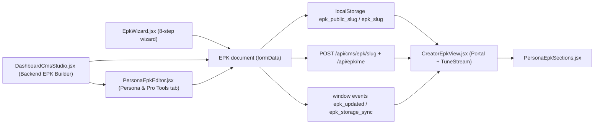

# EPK Creation & Persona Guide

How to design, structure and wire Electronic Press Kits (EPKs) on TuneMavens. Use this guide whenever you add a persona, add a section, or build a new creator's EPK.

---

## 1. Architecture

| Layer | File | Responsibility |
|---|---|---|
| Builder (CMS) | `apps/portal/src/components/DashboardCmsStudio.jsx` | Brand, hero, banners, assets, bio, discography, media, shows, store, press, contact, version history |
| Builder (Persona) | `apps/portal/src/components/PersonaEpkEditor.jsx` | Persona selection, booking email, DJ mixes, rate card, tech rider, podcast episodes, ad rates, demographics, beats, label roster |
| Wizard | `apps/portal/src/components/EpkWizard.jsx` | Guided first-time setup (domain → publish) |
| Public EPK | `apps/{portal,tunestream}/src/views/creator/CreatorEpkView.jsx` | Layout, header menu, tabs, theming, playback, checkout |
| Persona sections | `apps/{portal,tunestream}/src/views/creator/PersonaEpkSections.jsx` | Reusable persona blocks + canonical defaults |

> [!IMPORTANT]
> `PersonaEpkSections.jsx` exists in **both** apps and must stay identical. Edit the Portal copy, then copy it to TuneStream.

### Golden rule: every visible section is editable
1. Every section reads its content from the EPK document (`epkData.<key>`).
2. If the key is missing or empty, it falls back to a **canonical default** exported from `PersonaEpkSections.jsx` (`pickEditable(value, DEFAULT)`).
3. Every key has an editor in the CMS Studio or Persona & Pro Tools tab.
4. Saving writes to localStorage, the CMS API and the profile API, then dispatches `epk_updated` so open EPK tabs refresh immediately.

---

## 2. Data schema (EPK document keys)

| Key | Type | Used by | Editor |
|---|---|---|---|
| `creator_type` | `artist \| dj \| podcaster \| producer \| label` | Nav menu, home showcase, audience banner | Persona & Pro Tools |
| `artist_name`, `headline`, `bio`, `profilePhoto` | string | Hero, Bio | Brand / Bio |
| `themeBg`, `accentColor`, `secondaryColor`, `fontFamily`, `logoUrl` | string | Theme | Brand & Identity |
| `heroSlides[]` `{img,title1,title2,title3}` | array | Hero carousel | Hero Carousel |
| `pageHeaders{}` | map pageKey → image URL | Interior page banners | Page Header Banners |
| `tracks[]`, `albums[]` | array | Discography | Discography |
| `videos[]` | array | Media | Videos & Reel |
| `shows[]` | array | Shows & tickets | Tour & Shows |
| `products[]` | array | Store | Store & Merch |
| `pressQuotes[]`, `techRiderSpec`, `bookingAgency` | mixed | Press kit | Press & EPK |
| `bookingEmail` | string | Rate-card one-sheet, booking desk | Persona & Pro Tools |
| `dj_mixes[]` | `{id,title,dj_name,genre,bpm_avg,duration,commercial_price,price_credits,artwork_url,audio_url,description,is_original_ip_only,tracklist[]}` | DJ Mixes | Persona & Pro Tools |
| `rate_card[]` | `{id,tier,badge,duration,price_usd,deposit_pct,credits,audience,deliverables,hospitality,is_popular}` | DJ Rate Card, Gig Booking, download | Persona & Pro Tools |
| `tech_rider` | `{console[{label,value}], monitoring[{label,value}], notes}` | DJ Tech Rider | Persona & Pro Tools |
| `episodes[]` | `{id,title,seasonNumber,episodeNumber,duration,publishedAt,summary,transcript,audioUrl,chapters[{time,title}]}` | Podcast episodes | Persona & Pro Tools |
| `ad_rates[]` | `{tier,name,badge,price_usd,credits,cpm_usd,impressions,deliverables,is_popular}` | Sponsorship rate card | Persona & Pro Tools |
| `demographics` | `{topRegions[{region,share}], ageGroups, completionRate, listenerProfile}` | Audience telemetry | Persona & Pro Tools |
| `beats[]` | `{id,title,bpm,key,leaseUsd,stemsUsd,buyoutUsd,audioUrl}` | Producer beat store | Persona & Pro Tools |
| `roster[]` | `{name,slug,persona,genre,listeners,avatar}` | Label roster (links to `#/epk/slug?persona=`) | Persona & Pro Tools |

> [!NOTE]
> All prices are stored in a **USD base** and shown in the visitor's currency through `formatEpkPrice` (RegionContext). Never store localized strings in price fields.

---

## 3. Personas: audience, functions and layout

Each persona gets its own top menu (`getPersonaNavLinks`), audience banner (`PersonaAudienceCalloutBanner`) and home showcase.

### 🎵 Recording Artist
- **Audience:** fans, concert promoters, music supervisors, press.
- **Must-have functions:** lossless streaming and purchase, albums, tour tickets, merch store, press kit, booking and sync inquiry.
- **Menu:** Home · Bio · Shows & Tours · Discography · Media · Store · Booking.
- **Home order:** Hero → latest release → upcoming shows → merch → press quotes → contact CTA.

### 🎛️ DJ / Turntablist
- **Audience:** club promoters, festival talent buyers, brand event directors, mix listeners.
- **Must-have functions:** stream **and** buy rights-cleared mixes (40% DJ / 50% IP / 10% platform, or 90% for original IP), official **rate card** with **downloadable one-sheet**, **Book DJ for Gig** form with escrow deposit, booth **tech rider**, club and festival dates, bio and press.
- **Menu:** Home · Mixes (Stream & Buy) · Rate Card · Book DJ · Tech Rider · Dates · Bio.
- **Home order:** Mixes → Rate Card → Gig Booking form (anchor `#dj-epk-home-booking-anchor`).
- **Discovery:** DJ profiles on TuneStream must link to `/#/epk/{slug}?persona=dj`.

### 🎙️ Podcaster / Show Host
- **Audience:** brand sponsors, media buyers, PR publicists, listeners.
- **Must-have functions:** episodes with chapters and transcripts, sponsorship rate card (CPM, impressions), audience demographics, guest/sponsor pitch form.
- **Menu:** Home · Episodes · Ad Rates · Demographics · About · Press · Pitch.

### 🎹 Producer / Beatmaker
- **Audience:** recording artists, labels, music supervisors, vocalists.
- **Must-have functions:** beat store (MP3 lease / WAV stems / exclusive buyout), production credits, studio specs, mixing and custom rates, hire-producer form.
- **Menu:** Home · Beat Store · Credits · Studio Specs · Rates · Bio · Hire.

### 🏢 Record Label / Publisher
- **Audience:** music supervisors, DSP curators, festival buyers, A&R prospects.
- **Must-have functions:** signed roster linking to each artist's EPK, master catalog, sync licensing kit, blanket license request, showcases, A&R/demo desk.
- **Menu:** Home · Roster · Master Catalog · Sync Kit · Showcases · Overview · A&R Desk.

---

## 4. Design standards

| Element | Standard |
|---|---|
| Header | One fixed header only (`position: fixed; top: 0; z-index: 1000`). **Never** render banners or toolbars above or behind it. Group related tabs into dropdowns (max ~5 top-level items). |
| Radius | 3–4px on cards and buttons |
| Accent | `effectiveAccent` from the theme. Primary CTAs filled with the accent; secondary CTAs outlined. |
| Cards | `#0a0e20` background, `1px solid rgba(255,255,255,0.08)` border, 20–24px padding |
| Section header | Eyebrow (11px, uppercase, accent) → H3 (26px, 900 weight) → 13px muted description |
| Grids | `repeat(auto-fit, minmax(260–300px, 1fr))` so layouts reflow on mobile |
| Imagery | 16:9 hero/banners (1920×1080 / 1920×640), 1:1 artwork (≥800px). Always set an `onError` fallback. |
| Copy | Name the audience and the action ("Book DJ for Gig", "Download Rate Card"), not internal jargon |
| Test IDs | Add `data-testid` to every primary CTA and section |

---

## 5. Checklist: adding a new section or persona

1. **Defaults:** export a `CANONICAL_*` constant from `PersonaEpkSections.jsx`.
2. **Component:** accept the data prop, resolve it with `pickEditable(prop, CANONICAL_*)`, accept `accentColor` and `formatPrice`, and wire every button to a real handler.
3. **Mirror:** copy `PersonaEpkSections.jsx` to `apps/tunestream/src/views/creator/`.
4. **View:** pass `epkData?.<key>` in **both** `CreatorEpkView.jsx` files (home showcase and dedicated tab).
5. **Navigation:** add the tab to `getPersonaNavLinks` and the matching dropdown group in the header.
6. **Editor:** add a schema to `SCHEMAS` in `PersonaEpkEditor.jsx` (or a tab in `DashboardCmsStudio.jsx`) and render it for the persona.
7. **Docs:** add the key to Section 2 of this guide.
8. **Verify:** `cmd.exe /c "npm run build:portal && npm run build --workspace=tunestream"`. Then edit a value in the CMS, click **Save & Sync**, and confirm the open EPK tab updates without reloading.
