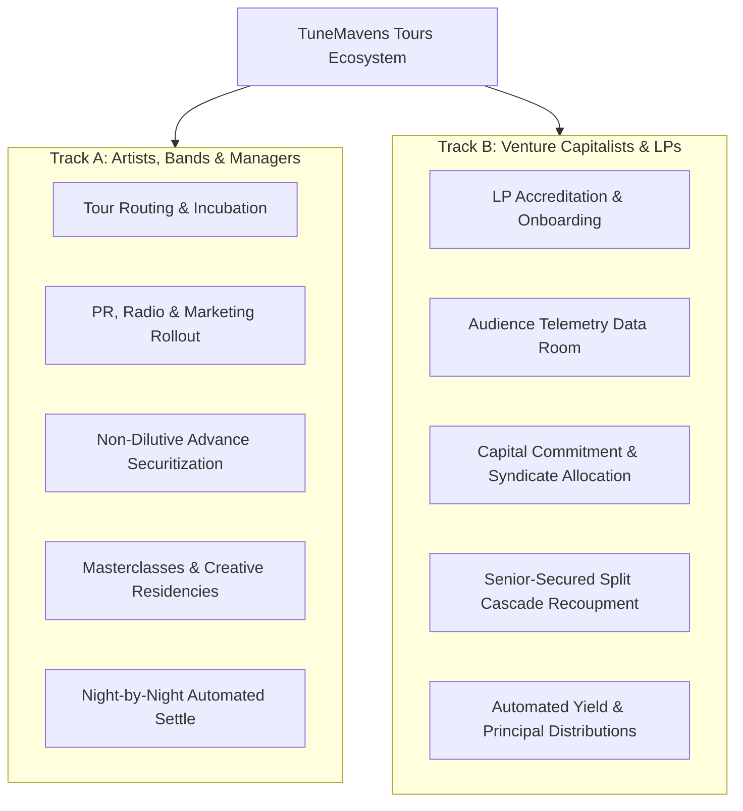
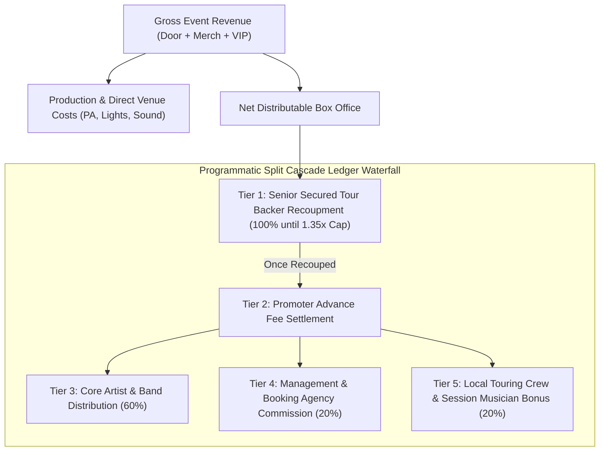

# Tour Venture Capital & Underwriting Vault: Comprehensive Guide

## 1. Executive Summary & Thesis
Live touring is the largest revenue driver in the modern music industry, yet traditional promoters and artists frequently encounter acute advance-capital constraints. Traditional bank debt is inaccessible to touring creators, while conventional record-label tour support often demands predatory 360-deal rights forfeitures (surrendering masters and publishing).

**TuneMavens Tour Venture Capital** transforms tour financing into an institutional-grade, data-underwritten asset class. Accredited investors, syndicates, and live-music funds can underwrite tour advances with programmatic, first-dollar recoupment through the **Split Cascade Ledger**, achieving **18.0% – 25.0% projected annualized IRR** with zero dilution to artist intellectual property.

---

## 2. Dual-Track Audience Architecture
TuneMavens maintains strict separation of concerns across two primary user tracks:

---

## 3. Investor Onboarding & LP Accreditation
To comply with regulatory standards and maintain underwriting integrity, institutional investors and accredited syndicates undergo a streamlined 4-step onboarding workflow:

### Step 1: Entity Structure & LP Profile
* **Entity Types**:
  * Individual Accredited Angel (Rule 506(c) accredited).
  * Venture Capital / Growth Equity Fund.
  * Music & Entertainment Syndicate.
  * Single / Multi-Family Office.
  * Corporate Sponsor / Cultural Fund.
* **Check Size Brackets**:
  * Micro-Allocation: \$5,000 – \$25,000.
  * Standard Syndicate: \$25,000 – \$100,000.
  * Lead Underwriter: \$100,000 – \$500,000+.

### Step 2: Regulatory Accreditation Attestation
* Self-attestation or third-party CPA/attorney verification letter verifying accredited investor status under SEC Regulation D or equivalent regional securities guidelines (e.g. UK FCA Qualified Investor, EU Professional Client).

### Step 3: Preferred Corridors & Risk Mandate
* Selection of target tour corridors:
  * Pan-African Highway (Nairobi, Lagos, Kigali, Accra, Johannesburg).
  * Western Europe (London, Berlin, Paris, Amsterdam, Brussels).
  * North American Circuit (New York, Chicago, Austin, Toronto, Seattle).
  * Asian Mega-Cities (Tokyo, Osaka, Seoul, Singapore).

### Step 4: Automated Distribution Setup
* Routing destination for recoupment payouts:
  * **Split Cascade Smart Contract Wallet** (direct instantaneous ledger payouts).
  * **M-Pesa Business Till / Paybill** (for East African regional accounts).
  * **SWIFT / Wire Bank Account** (USD/EUR/GBP institutional settlement).

---

## 4. Underwriting Telemetry Engine
Unlike traditional venture capital that relies on founder pitch decks, Tour VC underwriting is driven strictly by verifiable real-time audience engagement data:

| Telemetry Signal | Source System | Underwriting Threshold | Risk Weighting |
| :--- | :--- | :--- | :--- |
| **Streaming Velocity (MoM)** | TuneStream DSP Radar | > 25% Month-over-Month growth in tour stop cities | 30% |
| **Pre-Sale Ticket Waitlist** | Smart CRM Fan Database | > 1.8x venue capacity in verified opt-in fans | 25% |
| **Promoter Advance Inquiries** | EPK Builder Inquiry Log | Minimum 3 confirmed regional promoter bids | 20% |
| **Merch Spend Index** | TunePay Historical POS | Average \$18.50+ spend per attendee | 15% |
| **Social AI Conversion** | Social AI Engine | > 6.2% engagement-to-click conversion rate | 10% |

---

## 5. Recoupment Waterfall Mechanics (Split Cascade Ledger)
All box office ticket sales, VIP experiences, and merch desk proceeds are routed through the TuneMavens ecosystem (Ticketing Engine + TunePay Mobile POS). Revenues are programmatically settled through the **Split Cascade Ledger**:

### Recoupment Guarantees:
* **Senior Secured Status**: Investor capital holds First-Dollar Lien on all digital and physical ticket receipts before any artist net profit is released.
* **Escrowed Performance Guarantees**: For festival and co-headline slots, promoter guaranteed fees are held in smart escrow and disbursed directly to the investor recoupment wallet.
* **Audit Trail**: Every transaction is timestamped and cryptographically logged on the Split Cascade Ledger, accessible via the investor dashboard.

---

## 6. Underwriting Opportunities Carousel & Data Room
The Tour Underwriting Vault presents live syndicated deals in an intuitive, interactive card carousel:
* **Route Corridor & Artist Profile**: Comprehensive itinerary including venues, capacities, and dates.
* **Target Advance & Progress Bar**: Real-time allocation percentage, remaining syndicate balance, and minimum check size.
* **Projected IRR**: Dynamic calculation based on venue capacities, ticket tiering, and historical velocity.
* **Due Diligence Data Room**: Deep-dive telemetry modal revealing city-level streaming distribution, venue hold contracts, and downside scenario stress tests.
* **Direct Capital Commitment**: One-click investment commitment with instant ledger assignment.

---

## 7. Investor FAQ
### Q1: What happens if a tour date is cancelled due to force majeure?
All underwritten tours require cancellation and non-appearance insurance underwritten by accredited carriers. The policy names the Tour Backer Syndicate as primary loss payee.

### Q2: When do recoupment distributions begin?
Distributions begin on Night 1 of the tour. As ticket sales clear and TunePay POS transactions settle, funds flow through the Split Cascade Ledger directly to your payout wallet within 24 hours of each show.

### Q3: Are artists giving up their master recording or publishing copyrights?
**No.** TuneMavens Tour VC is strictly non-dilutive live tour advance financing. Artists retain 100% of their intellectual property rights.

---
*TuneMavens Tour Underwriting Vault • Technical Documentation Spec §9.44*
